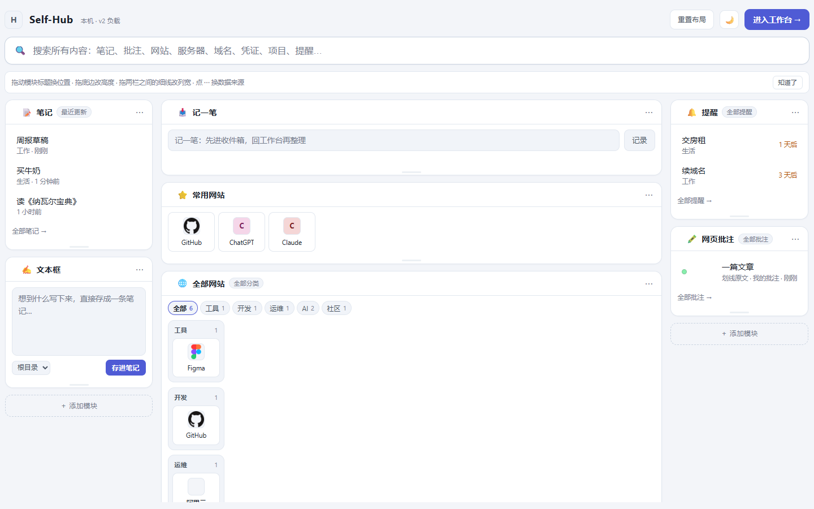
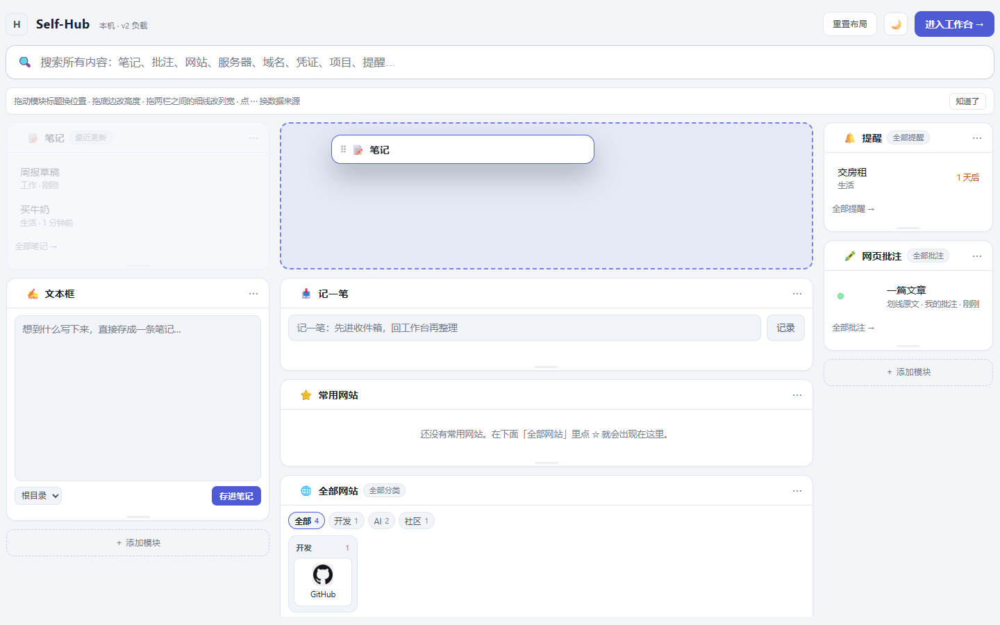

# 新标签页：可自定义模块面板

新标签页（`extension/newtab.html`）从一张写死的三栏，变成「模块面板」：每张卡片都能
拖动改大小、换位置、换数据来源，也能删掉或再加一张。



## 用户能做什么

| 操作 | 怎么做 | 存在哪 |
| --- | --- | --- |
| 改模块高度 | 拖卡片底边（或聚焦底边后按 ↑/↓，Shift 一次 64px） | `height`（px） |
| 改列宽 | 拖两栏之间的细线 | `columns[].fr`（比例） |
| 换位置 / 换栏 | 拖卡片标题（触屏用 `⋯` 里的上移 / 下移 / 移到左栏 / 移到右栏） | `column` + 数组顺序 |
| 换数据来源 | 卡片右上 `⋯` → 数据来源 | `source` |
| 加模块 | 每栏底部「＋ 添加模块」 | 新增 module |
| 删模块 | `⋯` → 删除模块 | 只删布局，不动数据 |
| 恢复默认 | 顶栏「重置布局」 | 覆盖为默认三栏 |

列宽存**比例**不存像素：窗口变宽时三栏按比例一起长，不会出现 1px 的缝或横向滚动条。
模块高度存像素：「我就要这么高」是明确意图，不该随窗口缩放。

## 模块类型

| 类型 | 内容 | 可选来源 |
| --- | --- | --- |
| `notes` 笔记 | 最近编辑的笔记 | 最近更新 / 指定文件夹 |
| `quicknote` 文本框 | 写完直接存成一条笔记 | 存到根目录 / 指定文件夹 |
| `capture` 记一笔 | 进收件箱，回工作台整理 | — |
| `pinned` 常用网站 | 点过 ☆ 的网站 | — |
| `sites` 全部网站 | 按分类成组，卡片套卡片 | 全部分类 / 只看某一类 |
| `checkins` 签到网站 | 一点就开的签到页 | — |
| `reminders` 提醒 | 按到期时间排序 | 全部 / 指定分类 |
| `annotations` 网页批注 | 最近划的词和批注 | 全部 / 指定网站 |

「网站」模块里是**卡片套卡片**：模块本身一张卡，每个分类一张子卡（`.subcard`），
每个网站还是一张卡（`.site-card`）。子卡按内容收缩，只有一两个网站的分类不会拉成
一条空荡荡的长卡。

## 文本框 → 笔记：为什么走队列

新标签页**不能直接写库**：工作台是 v2 负载 / v3 库的唯一写入方，第二个写入方正是
以前丢更新的原因。所以文本框把笔记追加到 `chrome.storage.local.selfhub_pending_notes`
（按 id 幂等），工作台打开或收到 `storage.onChanged` 时把它收进 `notes`，然后把这批
id 从队列里删掉（重新读队列再过滤，避免把导入期间新写的笔记一起清掉）。

- 新标签页会把自己刚写的笔记混进「笔记」模块显示，不用等工作台才看得到。
- 工作台没开着也不会丢：下次打开工作台时导入。
- 导入后队列清空，不会重复导入同一条。

## 记一笔 → 收件箱：为什么不是走队列

「记一笔」走的是另一条路：`CAPTURE_ENTRY` → 后台 → `ExtensionStore.captureEntry`，
落在扩展自己的 v3 收件箱（IndexedDB `selfhub_extension` → `inbox`）。popup、右键菜单
「保存至统一收件箱」也写这里。

这条链曾经断在工作台这一侧，而且断了很久——**它确实存下来了，只是存到了一个没人看的地方**：

1. 桥接层 `readExtensionCaptures()` 读的还是 `chrome.storage.local.selfhub_inbox`。
   那是 v2 时代的位置，`CAPTURE_ENTRY` 改成写 v3 库之后就没人写了，于是读到的永远是空。
2. 即使读到了，旧代码只在**启动时**导一次。工作台一般是一直开着的，所以用户记完
   切过去看，什么都没有——要刷新才出现。
3. `captureEntry` 把 `sender.tab.url` 当成捕获的来源 URL，而新标签页自己也是一个 tab，
   于是每条速记的 url 都是 `chrome-extension://<id>/newtab.html`。收件箱的行只要
   `url` 存在就**只渲染链接、不渲染正文**，结果是一条指向新标签页的空行——看起来
   就像"什么都没记"。

现在的形状：

- **读对了**：`readExtensionInbox()` 走 `QUERY_INBOX` 拿真正的行；老的
  `chrome.storage` key 仍然读，作为升级前的遗留数据兜底。
- **实时**：后台每次写入都 `broadcastChange(['inbox_v3'], …, 'capture')`，工作台监听
  `SELFHUB_CHANGED` 就地导入；再加 visibility / focus 补一次（页面睡着时消息不排队）。
- **一次性**：导入后把扩展侧的行标成 `status: 'imported'`。不标的话，用户在工作台把
  它转成笔记（行没了）之后，下次启动又会导回来——收件箱永远清不空。`imported` 是
  导入的墓碑，不是删除：侧边栏查全部状态，照样看得到。
- **URL 只认真实网页**：`CAPTURE_ENTRY` 只在 `sender.tab.url` 是 http(s) 时才借它当
  来源；扩展页面自己的地址不再冒充。读的时候也再过滤一遍，历史脏数据同样能正常显示。
- **正文和链接可以共存**：收件箱的行现在会同时渲染链接和正文（两者不同时），
  一条"从某个页面记下的文字"不会再被链接挤掉。

> 这是同一个坑的第二次：`docs/AUDIT_REPORT_2026-10-16.md` 里记着上一版——
> popup / 右键菜单 / 新标签页都提示"已保存"，但没有任何界面能读到。当时补了侧边栏，
> 这次补的是工作台，并且加了用例盯住它。

## 拖动为什么能跟手（Grafana 那套）



拖动卡顿在浏览器里只有一个根因：**读布局和写样式交替**。`el.style.height = ...` 只是
把元素标记成脏，真正回流发生在你下一次读 `clientWidth` / `getBoundingClientRect()` 的
时候。所以「写→读→写→读」的循环等于每一轮都强制同步回流一次。旧版正是这样：列宽拖动
每个 `pointermove` 都调一次 `applyWidths()`，而它第一行就读 `root.clientWidth`。

现在的三条规则：

1. **拖拽开始时量一次，过程中只写不读。** 列宽拖拽把容器宽度、两栏实际宽度都存成局部
   变量，之后每帧只写 `flexBasis` 两个值（不再同时写 `width`，少一半样式失效）。
   实测：60 次 `pointermove` 里读布局 **0 次**（旧版 60 次）。
2. **指针事件合并到 rAF。** 120Hz 鼠标一秒能发 200+ 个事件，一帧只处理一次。
3. **拖拽换位只做 transform，不改布局。**
   - 幽灵卡片 `.drag-ghost`：`position: fixed` + `transform: translate3d()` 跟指针，
     走合成层，不触发回流。
   - 落点用 `.drop-gap` 虚线槽预览，只在目标位置**真的变了**时才动 DOM
     （旧版每个事件都无条件 `insertBefore` 一次）。
   - 被挤开的卡片用 **FLIP** 滑过去：先量旧位置，改完 DOM 再量新位置，用反向
     `translateY` 起手动画回 0。不这么做卡片是瞬间跳一格，看着就是"卡"。
     重定位时先 `getAnimations().cancel()` 掐掉上一段，否则两段 `translateY` 同时跑会抖。
   - 同一栏内连续划过时复用上次量好的卡片中线，不再每个事件读一遍布局
     （实测：光标停在同一格时 0.28 次读/事件，旧版是每事件 N 次）。
4. 松手时把真卡片直接插进槽位、**不整页重绘**，所以落点没有闪一下。
5. 拖动/缩放时显示当前尺寸气泡（`.drag-badge`），和 Grafana 的 resize 提示一致。

### 为什么换位用 pointer events，不用 HTML5 拖放

一开始用的是 `draggable` + `dragover` / `drop`。CPU 侧其实一点都不贵（实测列宽拖拽每帧
强制布局 1.3ms / 高度 0.5ms，`dragover` 间隔中位数 0.8ms），但手感始终"拖在后面"——
因为 **`dragover` 的坐标不是指针的真实位置**：它由浏览器的拖放循环喂过来，系统会限频、
快速移动时还会丢掉中间几个点，幽灵卡片只能一路追。

换成标题栏上的 `pointerdown` + `pointermove` 之后：`pointermove` 由合成器按刷新率派发，
坐标就是指针位置。实测 60 次移动里幽灵卡片与"指针 + 14px"的偏差 **最大 0px**，
单次 `pointermove` 的处理耗时中位数 **0.1ms**。顺带甩掉了 HTML5 拖放的三件包袱：
每个 `dragover` 都要 `preventDefault`、自带一层不可控的半透明拖影、拖到窗口外就断流。

配套细节：

- 3px 位移阈值，没超过就当成点了一下标题栏（不闪幽灵卡片）；`pointerdown` 里
  `preventDefault()`，免得按住标题栏把标题选蓝。
- 命中测试和插槽更新仍合并到 rAF：高刷鼠标一秒能发上千个事件，一帧算一次就够。
- 放弃拖动走 `pointercancel` / `Esc` / 窗口失焦，这条路上**不提交**，卡片回原位。
- 触屏和键盘仍走 `⋯` 菜单里的「移到左栏 / 右栏 / 上移 / 下移」。
- 标题栏加 `touch-action: none`，触摸时不会先滚页面再开始拖。

### 拖到边缘自动滚动

指针停在栏底部不动时**没有任何事件**，事件流就断了 —— 所以"拖着一路往下、想放到看不见的
地方"以前根本放不进去，滚动条纹丝不动。这不是滚动条的问题，是压根没有滚动这件事在发生。

现在指针进入栏的上下边缘（`min(72, 12% 栏高)`，最少 40px）就开一个 rAF 循环持续滚：

- 速度随"深入边缘的程度"变化：`2 + 12 × √t` px/帧，约 120 → 840 px/s，`√` 让起步别太磨叽。
- 指针一离开边缘就停；滚到头（`scrollTop` 不再变化）也停，指针再动会重新起循环。
- 指针移出整个面板（比如拖到顶栏上）立刻停 —— 否则那一栏会自己一路滚到底。
- 滚动量换算成"平移缓存的视口中线"（`mid -= delta`），不重新量卡片：滚动不改尺寸，
  只改视口位置，所以滚动过程依然是**零布局读取**。
- 滚动期间槽位不做 FLIP 动画：内容本身在滚，再叠一层位移动画看着会发抖。
- 窄屏（≤1180px）每栏 `overflow: visible`，真正滚的是 window，那条路单独处理
  （滚动后同步平移栏的视口矩形）。

## 布局跟着备份走

新标签页是独立页面，`selfhub_newtab_layout` 和 `selfhub_newtab_pins` 一直只存在
`chrome.storage.local` 里 —— 所以以前备份带走了所有笔记和网站，却带不走你花时间排好的面板：
换台电脑恢复，布局没了。

现在这两份偏好会镜像进 `HubState.newtabPreferences`（和 `homeBlocks` 同一个思路：偏好属于
数据）。文件导出和 v3 加密批次本来就把整个 state 序列化，所以它们**自动**带上布局，不需要
改备份格式。

**方向只有两个，不会出现两个写入方：**

| 方向 | 时机 | 为什么 |
| --- | --- | --- |
| 拉（chrome.storage → state） | 工作台启动、`storage.onChanged` | 新标签页改了布局，工作台记下来 |
| 推（state → chrome.storage） | 只有恢复之后 | 这是唯一一次 state 比本地存储更可信 |

细节：

- 备份前会再读一次 `chrome.storage`（`withFreshNewtabPreferences`），覆盖"刚拖完卡片就点
  备份、`storage.onChanged` 还没回来"的竞态。
- 老备份没有这个字段时**不清空**本机布局：`writeNewtabPreferences` 只写存在的字段。
- 恢复后新标签页如果正开着，会通过 `storage.onChanged` 接住新布局并重画；不接的话用户下一次
  拖卡片就会把旧布局写回去，覆盖掉刚恢复的那份。
- 纯网页版没有 `chrome.storage`，这些函数全部退化成 no-op，payload 里就没有这个字段。
- `layout` 在工作台侧是**不透明**的：引擎拥有它的形状，工作台只负责存和还。

## 代码结构

- `extension/newtab-dashboard.js` — 布局引擎：列宽 / 高度拖拽、pointer 事件拖拽换位、
  添加 / 删除 / 数据来源弹层、`chrome.storage.local.selfhub_newtab_layout` 持久化。
  这一层不碰业务数据，模块内容由外部 `renderBody(module, bodyEl)` 画。
- `extension/newtab.js` — 数据读取（v2 负载 + v3 IndexedDB）、每个模块类型画什么、
  搜索、主题、待导入笔记队列。
- `extension/newtab.css` — 面板、拖拽条、模块卡、幽灵卡片 / 虚线槽 / 尺寸气泡、嵌套网站卡。
- `src/lib/extensionBridge.ts` — `readPendingNotes` / `acknowledgePendingNotes`。
- `src/lib/newtabPreferences.ts` — 布局 / ☆ 的读写桥：拉进 `HubState`、恢复后推回、
  以及备份前的 `withFreshNewtabPreferences`。
- `src/App.tsx` — 启动 + `storage.onChanged` 时把队列收进 `notes`，把布局镜像进 state。

## 约束

1. 只有布局变化才重建 DOM；数据刷新（点 ☆、切来源）只重画 `body`，否则会丢焦点和滚动位置。
   真的重建了（`render()` / `refreshBodies()`），也必须先用 `snapshotDrafts()` 把输入框里
   没提交的文字存下来、画完再 `restoreDrafts()` 填回去——用户写了一半的速记不该因为
   「工作台恢复了一份备份」而消失。
2. `chrome.storage.local` 里的常用网站 id，只有在**确实读到网站数据**时才裁剪失效项——
   数据没加载完就按「找不到就删」会清空用户的收藏。
3. 模块 `hidden` 必须显式写 `.module[hidden] { display: none }`：`.module` 是 flex 容器，
   会盖掉 `hidden` 的默认样式（签到模块没有站点时靠这条隐藏）。
4. 窄屏（≤1180px）单列堆叠，拖拽条隐藏、固定高度失效，避免手机上一屏一张卡。
5. **拖拽循环里不许读布局。** 要在拖动中用到尺寸，就在 `pointerdown` 里量好存起来。
   新增拖拽交互时先过一遍这条，否则又会退回"一卡一卡"。
6. 列宽只写 `flex-basis`（`.dash-col` 的 `flex: 0 0 auto` 提供 grow/shrink），
   不要再写 `width`——两个属性 = 两次样式失效。
7. 换位**不要**回到 HTML5 拖放（`draggable` / `dragover`）：它的坐标被系统限频，
   幽灵卡片必然拖在后面。要 1:1 跟手只能用 `pointermove`。
8. 涉及工作台的用例读的是 `extension/app` 里**打包好的** bundle，不是 `src/`。
   改完 `src/` 先 `npm run package:extension`；`tests/e2e/packagedApp.ts` 会检查
   产物是否比源码新，忘了打包会直接红，而不是拿着旧代码给出假绿。

## 验证

```powershell
npx playwright test --config=playwright.extension.config.ts
```

`tests/e2e/newtab-dashboard.spec.ts`（14 条）覆盖：拖高 / 拖列宽（刷新后仍在，且列宽只写
`flex-basis`）、拖标题换栏、拖动中出现幽灵卡片 + 虚线槽且松手前数据不动、拖到一半放弃
（`pointercancel`）布局回到原位、拖到栏底自动往下滚（指针不动也滚、离开边缘就停、
落点跟着滚动走）、加文本框并把内容变成笔记、按文件夹换来源、网站卡片套卡片与分类 chip、
**重画面板不清掉正在写的速记**、文本框 → 打开工作台能看到这条笔记且队列清空、
**记一笔 → 工作台收件箱（不刷新就出现，且扩展侧标成 `imported` 不会重复导入）**、
删模块持久化与重置布局。

`tests/e2e/newtab-backup.spec.ts`（3 条）覆盖布局跟着备份走的两个方向：新标签页改的布局
被工作台收进 payload（含常用网站 id）、工作台关着时改的布局在下次打开时补上、导入备份把
布局和 ☆ 写回 `chrome.storage`，以及**老备份没有这个字段时不会清掉本机布局**。

拖动性能的量化手段（临时脚本，不进仓库）：包一层 `Element.prototype.getBoundingClientRect`
和 `clientWidth` 的 getter 数读次数，再用合成 `PointerEvent` 跑 60 帧；跟手精度则是在每个
`pointermove` 之后同步读 `.drag-ghost` 的位置，和"指针坐标 + 偏移"比对。
