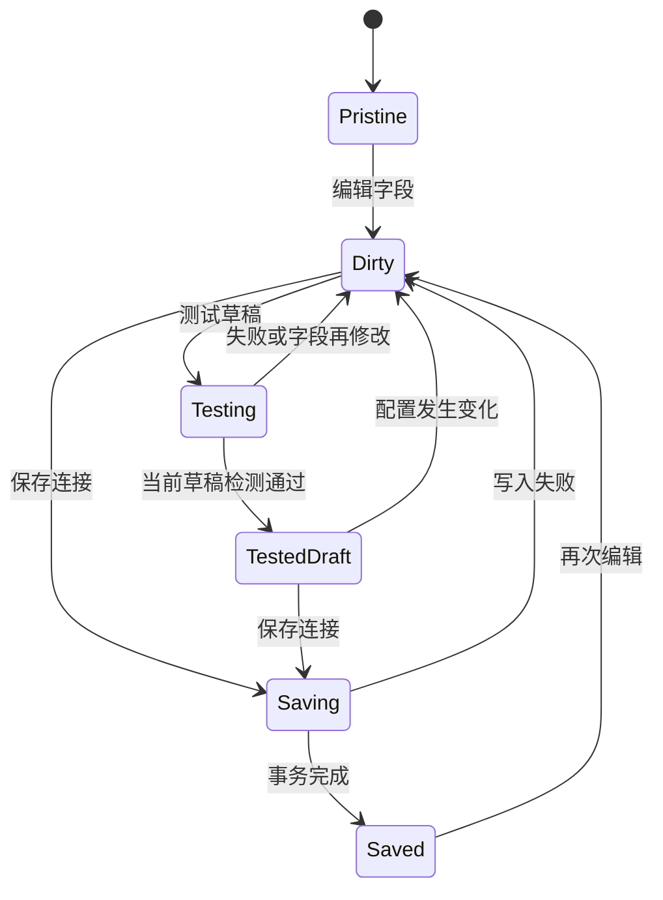

# Self-Hub 综合站详细开发文档

版本：设计稿 1.0 ｜ 日期：2026-10-18 ｜ 状态：待评审、未实施

本文件是开发规格，不是当前系统已具备能力的说明。产品目标与页面结构见[重设计方案](superpowers/specs/2026-10-18-self-hub-redesign-design.md)，任务顺序见[实施计划](SELF_HUB_IMPLEMENTATION_PLAN.md)。用户已确认快捷导航、资料管理、资源与日常管理全部需要。

2026-10-23 已实施的首页、导航及常用页面简化见[布局调整说明](LAYOUT_SIMPLIFICATION.md)，其中记录本次页面行为、实现位置和验收方式。

## 1. 开发目标与强制约束

### 1.1 本次改版必须解决的问题

1. 每个功能有明确入口，三类使用场景在一个工作台里连续完成。
2. 创建、查找、整理、处理提醒、配置连接都有完整的状态与失败路径。
3. 一个连接只维护一份凭据；用途和后台任务引用该连接，不复制另一份表单。
4. 用户能区分本机保存、远端文件保存、时间点备份和多设备同步。
5. 迁移不依赖用户清空浏览器；旧数据先核对再切换，失败可恢复。
6. 阶段交付可单独使用；不能做完外观就宣布存储和同步问题也已解决。

### 1.2 版本边界

| 版本 | 交付边界 | 允许保留的过渡行为 |
| --- | --- | --- |
| P1 界面与配置重组 | 完整工作台、全模块入口、配置语义、备份触发修复 | 暂用 HubState v2 和旧集合，经统一适配层访问；明确环境边界 |
| P2 本地与扩展统一 | 事务存储、扩展单写入口、连接引用、可靠备份和迁移 | 网页与扩展仍为独立本机库，以导入导出交换 |
| P3 多端与 Obsidian | 可选 API、设备配对、增量同步、插件 | 没有部署服务仍可完整使用 P2 |

P1 各业务页面迁移不能遗漏服务器、金库、签到与手绘。P2 引入统一数据模型时通过适配器替换 P1 的数据实现，不再重写一遍界面。

### 1.3 不变量

- 未启用云端 AI 不发 AI 网络请求；检测连接属于用户主动发起的独立请求。
- 连接字段填写不隐式启用备份、索引、AI 或自动签到。
- 保存成功必须有已完成的持久化依据；P1 反馈真实旧存储结果，P2 等待事务完成。
- 密钥、密码、Cookie、请求授权头不进入普通检索索引、应用日志或 URL。
- 文件冲突、恢复冲突和跨设备冲突不通过“最后一次写入覆盖”静默消除。
- 不在业务层判断当前是否扩展、选择 OSS/WebDAV 或直接操作浏览器存储。
- 隐藏导航、暂停任务、锁定金库、删除数据是四种独立动作。

## 2. 当前代码基线与处理方式

| 当前文件 | 保留内容 | 改造要求 |
| --- | --- | --- |
| `src/App.tsx` | 应用装配、现有行为参考 | 逐步成为 AppShell，不继续堆业务状态与任意 tab 字符串 |
| `src/components/Sidebar.tsx`、`Navbar.tsx` | 图标、成熟交互参考 | 共用导航与动作注册表，按断点只显示一套全局操作 |
| `src/components/views/*` | 已有 CRUD、编辑器、项目关联 | 先适配路由与统一反馈，再替换仓库；避免外观阶段重写业务算法 |
| `src/components/modals/SettingsModal.tsx` | 现有配置覆盖面和恢复入口 | 拆为独立设置路由；删除无真实保存含义的底部按钮 |
| `src/components/settings/IntegrationCard.tsx` | 注册表生成字段的思路 | 删除连接表单失焦提交，增加草稿校验、版本和异步保存结果 |
| `src/lib/integrations.ts` | 连接注册机制 | 扩为能力注册表，拆分连接/用途/运行结果 |
| `src/lib/features.ts` | 现有关闭项与兼容规则 | 映射为导航偏好和模块可用性，保留已有用户设置 |
| `src/hooks/use*Actions.ts` | 领域动作与跨领域编排经验 | 动作调用应用用例层；跨集合转换由事务支持 |
| `src/lib/storage.ts` | v2 解析、备份兼容、旧数据恢复 | P1 LegacyRepository；P2 迁移读取器及旧格式导入器 |
| `src/lib/indexedDb.ts` | 现有库结构、容量和清理经验 | 有版本的 schema 升级；不能将异步镜像等同于事务主存储 |
| `src/lib/stateBackup.ts`、`useCloudBackup.ts` | OSS/WebDAV 传输和既有格式读取 | P1 统一目标解析；P2 拆格式、调度、执行、恢复与诊断 |
| `src/lib/extensionBridge.ts` | 环境判定、消息边界参考 | 迁移后删除整集合覆盖；改为受控命令与查询 |
| `src/lib/s3Client.ts`、`webdavClient.ts` | 签名、分页、冲突探测、文件操作 | 置于基础设施适配层，不允许组件拼存储路径和签名 |
| `src/lib/crypto.ts`、`trustedDevice.ts` | 已有加密格式和设备信任实现 | 保持旧数据可解密，独立加密格式升级需迁移测试 |
| `src/lib/searchEngine.ts`、`vaultIndex.ts` | 检索、远端索引、双链 | 统一结果描述和范围提示；索引可重建，不能是唯一正文副本 |
| `src/lib/markdown/*`、`MarkdownEditor.tsx` | 共用渲染、编辑器、大纲、草稿 | 继续复用，不在资料库另造第二套 Markdown 规则 |
| `extension/options.*`、`newtab.*`、`sidepanel.*` | MV3 入口与现有采集行为 | 设置入口最终打开打包应用的同一设置页，新标签页共用领域 SDK |
| `extension/sync/*` | 旧同步数据读取与迁移兼容 | P2 验收后停写，保留受控导入器，不作为第二同步引擎 |

旧文档的测试数量属于历史记录。本轮只检查代码与页面，不声称已重新运行历史全量测试。

## 3. 架构与目录

保持当前单仓库与现有构建工具。模块拆分不要求先引入 monorepo、服务端或大型状态库。

```text
src/
  app/                  AppShell、路由、环境能力、页面级边界
  domain/               实体、约束、日期/排序/引用规则；不依赖 React
  application/          用例：记录、转换、关联、配置、备份、迁移
  repositories/         契约与 Legacy/IndexedDB 实现
  integrations/         注册表、能力声明、连接校验与诊断
  infrastructure/
    storage/            IndexedDB schema、事务、迁移
    transport/          OSS、WebDAV、扩展消息；P3 增加 API
    security/           加密、凭据存储、脱敏与解锁策略
    jobs/               任务队列、调度、重试、租约
  features/
    home/ navigation/ inbox/ library/ projects/
    resources/ reminders/ tools/ settings/
  shared/ui/            Button、Dialog、Field、Status、EmptyState 等
extension/
  background.js         MV3 事件入口，调用打包后的共享用例
  content.js            选择/锚点/绘制，不持有服务商凭据
  newtab.* sidepanel.*   共享仓库接口的轻入口
  app/                  构建产物，不作为手工修改源
```

依赖方向：页面 → 用例 → 仓库契约/领域规则；适配层实现契约。领域层不能反向引用 React、Chrome API 或网络客户端。跨领域操作如“收件箱转笔记并关联项目”是一个应用用例，不能由三个组件各自补写。

## 4. 路由、导航与页面契约

### 4.1 路由方式

采用 Hash 路由以兼容静态托管与扩展内路径，第一阶段不增加额外路由依赖。内部路由类型和解析集中维护；业务组件不能自行拼地址。以后切 History 路由需独立处理托管 fallback。

| 路由 | 页面 | 查询状态 |
| --- | --- | --- |
| `#/home` | 首页 | 无敏感查询参数 |
| `#/navigation` | 快捷导航 | group、q、layout |
| `#/inbox` | 收件箱 | state、project、selected |
| `#/library` | 资料库 | type、source、tag、project、q、selected |
| `#/library/item/:id` | 条目详情 | mode；远端文件通过内部映射 ID 定位 |
| `#/projects`、`#/projects/:id` | 项目列表/详情 | status、section |
| `#/reminders` | 提醒 | range、category、selected |
| `#/resources/servers` | 服务器 | env、status、selected |
| `#/resources/assets` | 域名、订阅与证书 | kind、expiring、selected |
| `#/resources/vault` | 金库 | 只允许记录 ID，不允许明文或解锁 token |
| `#/tools/checkins` | 签到 | selected |
| `#/tools/drawing/new` | 手绘 | draftId |
| `#/settings/:section` | 设置 | section 白名单见设计文档 |
| `#/settings/connections/:id` | 连接详情 | tab=details/tasks/history |

迁移兼容：旧 `activeTab` 值只在入口适配处转成路由。非法路由显示“页面不存在”并提供回首页；已删除条目显示可返回的缺失状态。浏览器前进/后退必须恢复页面，不重新执行保存。

### 4.2 导航与动作注册

导航定义字段：id、label、route、group、icon、capability、children、defaultPinned。导航显示偏好由用户保存；后台能力不取决于导航是否显示。

动作定义字段：id、label、scope、shortcut、availability、execute。搜索、新建、记录、打开设置只定义一次，桌面/手机渲染同一来源。界面只在可输入以外的上下文响应全局快捷键，不能覆盖编辑器原有快捷键。

### 4.3 页面通用状态

每个页面必须实现 initial-loading、ready、empty、error；按需增加 partial、locked、offline、unsupported。空状态和错误不可复用为一个“没有数据”。每个异步动作有提交中和重复点击保护，失败后保留用户输入。

表格过滤项改变回到第一页；选择集与当前页分开，批量操作明确“本页选中”或“全部匹配”。列表按稳定 ID 渲染，不能把数组下标当实体 ID。

## 5. P1 过渡实现规则

P1 先解决使用和配置问题，不同时切换所有数据格式。

1. `LegacyHubRepository` 包装 `loadHubState/saveHubState`，页面只接收查询结果和异步动作结果。
2. 页面选择器组合现有 sites/notes/annotations/handwritings 等集合，形成统一资料列表，不复制内容到第二个数组。
3. 配置编辑保留私有 draft；只有明确提交时调用旧注册表写回。`IntegrationDef.write` 不再根据字段有无推导 enabled。
4. 引入明确 `backupPolicy`，包括 enabled、provider、connectionId/legacyRef。旧 OSS、WebDAV 同时存在时展示当前实际选择，不再静默按 WebDAV 优先。
5. `resolveBackupTarget()` 同时用于手动备份、自动触发和状态显示；只配 WebDAV 的情况必须加入回归测试。
6. 已有备份任务如果保持启用，其实际目标和频率保持；信息不足或旧双同步存在冲突时先进入“需确认目标”，不擅自停掉唯一备份，也不继续增加新写路径。
7. 旧扩展同步在 P1 被明确标注“旧版独立同步”，展示覆盖范围与目标；P2 接管前不宣称已合并。
8. `saveHubState` 返回失败时不得显示“已保存”。IndexedDB 异步兜底仅作为待核实恢复副本，不覆盖失败事实。

P1 仍会受旧存储容量、整包写和独立扩展数据边界限制。这些限制在状态详情中说明，P2 专项解决。

## 6. P2 数据模型

### 6.1 标识、版本与时间

- 新实体 ID 使用随机 UUID；迁移实体保持原 ID 或通过持久映射换成命名空间 ID，不按标题生成。
- 所有业务实体、正文、引用、附件、连接、用途和任务都带 `libraryId`；主键采用 `[libraryId, id]`（正文用 `[libraryId, itemId]`）。相关索引均以 libraryId 为首段，跨库引用禁止。设备密钥、当前 activeLibraryId 等设备元信息单独按 key 保存。这样恢复到暂存库不会提前覆盖当前有效库中的同 ID 记录。
- 本地 `revision` 是单库内单调递增整数；P3 的 `serverRevision` 独立，不把设备 A 的本地整数与设备 B 直接比较。
- 时刻用毫秒时间戳；“到期日”另存 `YYYY-MM-DD` 和用户时区，避免午夜偏移改变日期。
- 删除先写 `deletedAt`；回收站保留 30 天，清空需明确确认，远端文件回收遵循其独立规则。
- 模型版本固定为 3；旧格式 v2 只通过迁移器/导入器进入。

### 6.2 核心对象

| 对象 | 主要字段 | 责任与约束 |
| --- | --- | --- |
| ItemMeta | id、kind、title、tags、projectIds、sourceRef、createdAt、updatedAt、revision、deletedAt | 统一列表、过滤、引用；kind 为 note/webpage/drawing/attachment/bookmark |
| NoteBody | itemId、markdown、revision | 本地正文；一个 item 一份正文 |
| Bookmark | itemId、url、groupId、position、pinned、visitCount、lastVisited | 快捷导航与资料库收藏共用同一实体 |
| WebPage | itemId、canonicalUrl、originalUrl、pageTitle、capturedAt、snapshotAttachmentId | 网页资料聚合，不把 URL 相同直接等同于内容相同 |
| Annotation | id、pageItemId、quote、comment、color、tags、anchor、anchorState、revision、deletedAt | 批注属于网页；原文与用户评论分开 |
| InboxEntry | id、rawText、url、status、resultRefs、operationId、createdAt | 临时输入与整理结果；与正式 Item 的关系可追踪 |
| Project | id、name、description、status、repoUrl、deployUrl、decisions、revision | 项目主体 |
| EntityLink | id、fromType、fromId、toType、toId、relation | 资料/项目/资源/提醒/凭证的引用；组合唯一 |
| Server | id、name、env、addresses、sshOptions、healthUrl、lastProbe、expiresOn、timezone、revision | 不包含明文 SSH 密码；密钥引用 Credential |
| ResourceAsset | id、kind、name、provider、managementUrl、expiresOn、timezone、cost、revision | 域名/订阅/证书等到期资源；项目和凭证用 EntityLink 关联 |
| Credential | id、name、category、encryptedValue、iv、salt、cryptoVersion、expiresOn、revision | 保持兼容解密；普通列表不读取明文 |
| Reminder | id、title、dueOn、timezone、recurrence、status、resourceRef、revision | 独立提醒或资源引用；每轮完成记录单独保存 |
| CheckInTask | id、name、targetUrl、method、executionMode、secretRef、schedulePolicy、enabled、revision | 请求授权信息通过本机密钥引用 |
| CheckInRun | id、taskId、scheduledFor、startedAt、finishedAt、outcome、safeMessage | 执行事实，不把打开页面记为 success |
| Attachment | id、itemId、name、mime、size、hash、location、localBlobId、remoteRef、availability | 元数据与二进制分离；可报告缺失 |
| RemoteDocument | id、connectionId、key、etag、modifiedAt、size、cachedBodyRef、cacheState | OSS 远端索引条目，不能与本地 NoteBody 混写 |
| Connection | id、provider、displayName、publicConfig、credentialRef、configVersion、verification | 非敏感配置与凭据引用 |
| ConnectionCredential | id、encryptedEnvelope、keyMode、updatedAt | 本机专用；不进入常规备份 |
| PurposeBinding | id、purpose、connectionId、enabled、options、configVersion | backup/remote-vault/ai/source-import 等用途绑定 |
| Job | id、kind、bindingId、scopeKey、state、attempt、nextRunAt、lease、inputRevision、result | 所有后台任务的持久事实 |
| Preferences | homeBlocks、navPins、theme、density、searchEngines、onboardingVersion | 使用偏好；与能力启停分开 |
| MigrationReport | id、from、to、phase、counts、conflicts、unknownFields、mappingRef、checkpoint | 迁移与回退依据 |

P1 不强制一次创建全部对象；P2 切换后对象含义必须一致。项目原来的 noteIds/siteIds/serverIds/reminderIds 统一转 EntityLink。

### 6.3 URL 与重复处理

- 保留 originalUrl；去 fragment、主机大小写、默认端口等仅用于候选匹配。
- 未证明为追踪参数的 query 不删除；不同 query 的业务页面不能静默合并。
- 收藏重复由 URL 候选加用户确认处理；批注重复由来源 ID/稳定映射判定，不只比较 quote 文本。
- 五彩与扩展记录 ID 冲突时使用 `source + legacyId` 命名空间；正文相同但批注不同保留两条待核对记录。

### 6.4 本地事实来源与事务

继续使用数据库名 `self_hub_idb`，P2 将数据库版本从 1 升级为 2。新增 store 使用 `_v3` 后缀，与旧 notes/sites 等镜像 store 隔离：items_v3、note_bodies_v3、bookmarks_v3、webpages_v3、annotations_v3、inbox_v3、projects_v3、entity_links_v3、servers_v3、resource_assets_v3、credentials_v3、reminders_v3、checkins_v3、checkin_runs_v3、attachments_v3、blobs_v3、remote_documents_v3、connections_v3、connection_credentials_v3、bindings_v3、jobs_v3、settings_v3、migrations_v3。业务 store 按第 6.1 节采用库作用域复合主键，设备级元信息与迁移报告使用单独 key。旧 store 在迁移保留期只读。

必要索引：kind+updatedAt、sourceRef、tags 多值、projectIds 多值、groupId+position、canonicalUrl、pageItemId、dueOn+status、connectionId、job state+nextRunAt、EntityLink 的组合唯一键。导入和查询在运行时做 schema 校验，不能只靠 TypeScript 类型断言。

仓库事务操作必须保证：

- 新建笔记：ItemMeta + NoteBody + 有需要的项目关联一次提交。
- 收件箱转换：目标条目 + 状态 + resultRefs + 幂等结果一次提交。
- 保存配置：Connection + Credential + Binding 版本关系一次提交。
- 修改业务数据：实体 revision + 全局 contentRevision + 必要任务意图一次提交。
- IDB `complete` 后才回传持久化成功；请求 `onsuccess` 不作为整个事务完成依据。

网络请求、加密耗时操作、文件读入在事务外完成，事务内只进行数据库读写和约束检查。事务范围有限，不把整库导入塞进一个会阻塞界面的超大事务。

本地缓存/UI store 只负责显示订阅和短期编辑状态，不保留第二份长期真相。localStorage 在切换后仅留主题启动提示和兼容引导标记；不能继续写 HubState 作为另一个主库。

## 7. 应用用例与接口契约

本节描述内部接口；P1 可由旧存储适配，P2 由事务仓库实现，不是已经存在的 HTTP API。

### 7.1 通用结果

所有写操作返回：ok、operationId、entityRefs、persistedRevision、warnings。失败返回统一 AppError，禁止把密码/Authorization/raw response dump 放进 message。

AppError 字段：code、userMessage、safeDetail、retryable、suggestedAction、correlationId。建议 code 包含 VALIDATION、NOT_FOUND、LOCKED、QUOTA_EXCEEDED、UNSUPPORTED_ENV、AUTH_FAILED、FORBIDDEN、NETWORK_UNREACHABLE、REMOTE_CONFLICT、REVISION_CONFLICT、MIGRATION_REQUIRED、CANCELLED。

### 7.2 用例清单

| 用例 | 输入 | 输出与关键约束 |
| --- | --- | --- |
| CaptureEntry | rawText/url、source、operationId | 持久 inboxId；无需云连接；重复 operationId 返回同一条 |
| ConvertInboxEntry | inboxId、targetKind、projectIds、expectedRevision、operationId | 目标引用；重复转换复用原目标；状态仅在目标提交后改变 |
| Create/UpdateBookmark | 字段、expectedRevision | 收藏 ID；URL 校验、分组排序、打开动作不触发编辑 |
| ReorderBookmarks | groupId、orderedIds、expectedGroupRevision | 稳定顺序；遗漏/重复 ID 拒绝提交 |
| SaveNote | id、markdown、baseRevision、draftId | 事务后的 revision；并发冲突保留草稿 |
| SaveDrawing | title、Blob、projectIds、operationId | Attachment 与 Item；空画布不保存；二进制超限可操作提示 |
| SearchEverything | query、scope、filters、cursor、limit | 按类型归组结果、snippet、coverage、nextCursor |
| LinkEntity | from、to、relation、operationId | 幂等引用；检查目标存在及类型 |
| ProbeServerHttp | serverId、operationId | 检测结果、时间、延迟；不可访问不直接推断主机宕机 |
| SaveResourceAsset | kind、字段、expectedRevision、reminderOptions | 资源与可选引用提醒一次提交，到期日期只维护一处 |
| CopyCredential | credentialId、unlockSession | 仅到复制上下文；不返回给首页或索引 |
| Complete/RescheduleReminder | reminderId、occurrenceId、action、baseRevision | 本轮完成事实及下一日期；重复完成不多次顺延 |
| ExecuteCheckIn | taskId、operationId | runId；HTTP 业务判定与仅打开页面分开 |
| TestConnection | draft、draftVersion、requestedCapabilities | 检测报告，绝不保存草稿或启用用途 |
| SaveConnection | draft、expectedConfigVersion | connectionId、新版本、待测试/继承测试结果 |
| EnablePurpose | connectionId、purpose、expectedVersion、options | bindingId；校验能力、环境和凭据可用性 |
| RunBackup | bindingId、requestedRevision、operationId | jobId；任务提交与实际完成分开反馈 |
| PreviewRestore | archive、password、options | 只读差异报告、验证结论、缺失附件、冲突候选 |
| ApplyRestore | previewId、expectedLocalRevision、strategy、operationId | 新恢复批次；数据变化后旧预览失效 |

分页 limit 默认 50，最高 200。首页只查询所需的前 6–12 项，不加载整库正文。搜索片段对不可信 HTML 按文本渲染，不直接 innerHTML。

## 8. 连接注册表与设置状态机

### 8.1 注册表必须包含

provider、displayName、fieldSchema、sensitiveFields、capabilities、supportedEnvironments、validateDraft、testCapabilities、normalizePublicConfig、credentialExtractor、diagnosticMapper。UI、配置校验、用途选择共用同一声明。

能力集合按事实标注：listFiles、readFile、writeFile、deleteFile、snapshotBackup、sourceImport、cloudIngest。某服务提供商支持什么由适配器声明；不能因 API Token 已填写就显示所有能力可用。

### 8.2 两套状态机



用途另有 Disabled / Enabled / Paused / Blocked。任务另有 queued / running / succeeded / failed / conflict / cancelled / waiting-unlock。不要把三套状态压进一个 `configured: boolean`。

检测报告绑定 `configVersion` 或精确 draft fingerprint（不记录凭据明文），包含 checkedAt、environment、capabilities 和 safeError。字段变更使报告失效；不把旧检测成功沿用到新密钥或新目录。

### 8.3 检测协议

- OSS：确认目标 bucket/prefix 可列出；按用途测试读取、写入及必要删除权限。
- WebDAV：对目标地址做 PROPFIND；备份用途再在隔离目录测试 PUT/GET/DELETE，并读回比对内容。
- AI：说明会发起短测试且可能计费；用户主动测试后只发送固定非个人内容。
- 只读笔记库不要求写权限；写权限不足不能用只读通过冒充可备份。
- 临时检测对象使用独立随机路径，记录到清理任务；无删除权限时报告残留路径并不重复无限创建。
- 测试路径、重定向目标、请求方法由适配器控制；不能由 content script 传任意 URL 让后台替它代理。

错误归因：401 认证失败；403 权限不足；404 目标不存在；网络失败/CORS 不可确定时显示“当前环境无法访问，可能是跨域、网络或证书问题”，不能仅凭 TypeError 断言 CORS。提供“在扩展中测试”或诊断帮助。

连接被引用时，删除操作先列出用途，默认只暂停与断开；不删除远端数据。更换路径或提供商先测试新目标，再明确切换绑定，不自动搬动旧目录。

## 9. 扩展、网页与共享设置

### 9.1 权威位置

| 运行环境 | 领域写操作所有者 | 数据位置 | 设置入口 |
| --- | --- | --- | --- |
| 普通网页 | 该网页源的仓库服务 | 当前 origin IndexedDB | 站内设置 |
| 扩展新标签页/侧栏/打包应用 | 扩展后台命令处理器 | 扩展 origin IndexedDB | 打包应用同一设置路由 |
| content script | 无直接仓库/凭据访问 | 只缓存当前页必要锚点 | 扩展侧栏或应用设置 |

扩展 options 页只负责跳转 `app/index.html#/settings/browser` 等统一入口。使用偏好通过同一仓库查询；不再在 options.js 中保留第二套 S3/WebDAV 密钥表单。

普通网页没有配对时只显示本源数据与模式说明。第一、二阶段不实现隐式跨源同步、不依赖万能 postMessage 桥。需要从普通网页迁往扩展时提供加密迁移包和数量预览；第三阶段才可配对同一同步服务。

### 9.2 消息格式

请求字段：protocolVersion=1、requestId、command、payload。响应字段：requestId、ok、data 或 AppError。允许命令是固定白名单，例如 CAPTURE_ENTRY、QUERY_BOOKMARKS、SAVE_ANNOTATION、QUERY_PAGE_ANNOTATIONS、GET_TASK_STATUS、OPEN_WORKSPACE。

- 后台验证 sender 的扩展 ID、URL、tab 情境和命令权限。
- content script 仅可读当前页相关批注、提交采集操作；不能请求任意凭证、配置导出或任意 URL 代理。
- 页面 URL 应与 sender.tab.url 或授权上下文匹配，不能信任 payload 声称的页面来源。
- 请求和响应均有运行时 schema 校验，拒绝未知字段和超大 payload；正文/附件走受限导入入口。
- 写命令携带 operationId；后台持久化幂等结果，应答丢失后重试不重复新增。
- 变更事件仅包含实体 ID、类型和 revision，不广播正文或凭据。
- 新标签页初始化后读快照与 revision，再订阅变更；重开/后台重启可重新查询，不依赖上次内存监听状态。

### 9.3 MV3 生命周期与任务

MV3 后台可能休眠或被终止，内存布尔锁和普通计时器不能作为唯一执行保障。任务状态、重试时间、租约和幂等记录持久化，启动/事件/alarms 唤醒时重新扫描可运行任务。参考 [Chrome service worker 生命周期](https://developer.chrome.com/docs/extensions/develop/concepts/service-workers/lifecycle)。

凭据和任意网页跨域请求不下放到 content script。只有扩展页或后台在获得相应 host permission 后执行受控请求；content script 仍受页面来源约束。参考 [Chrome 跨域请求说明](https://developer.chrome.com/docs/extensions/develop/concepts/network-requests)。

P2 迁移验收后关闭旧 `SyncManager.performSync` 写入和旧 app→extension 整集合覆盖。停写标记需在后台恢复时检查，不能只在前端点击时改变一个内存变量。

## 10. 保存、备份、远端文件和同步

### 10.1 四类动作命名

| 动作 | 成功的依据 | 用户状态 |
| --- | --- | --- |
| 本机保存 | 本地事务完成 | 已保存在此设备 |
| 远端笔记保存 | 远端对象写入成功且版本检查通过 | 已保存到笔记库，附时间 |
| 备份 | 快照完成、清单可读、提交标记可验证 | 备份完成，附范围与时间 |
| 多设备同步（P3） | 服务端确认操作并更新本机游标 | 已同步至服务，仍需目标设备拉取 |

不以队列创建成功冒充云端完成；不以 A 设备上传成功冒充 B 设备已接收。

### 10.2 P2 备份策略

- 一个库只设置一个默认自动备份绑定；允许手动“另存备份”，不同时启动两套覆盖同范围的自动写入。
- 自动备份仅由内容 revision 变化触发，5 秒合并短时间修改。任务状态、备份时间变化不再次触发备份循环。
- 本机绑定的凭据不可用时任务进入 waiting-unlock 或 blocked，不显示备份成功。
- 网页只在页面运行时自动备份；扩展在浏览器运行时利用事件和 alarms 补做。两者都不能承诺关机后继续工作。
- 同一个 backup scopeKey 使用持久租约串行执行；租约过期可回收，应答丢失通过最终提交标记判定是否完成。
- 可重试网络失败按 30 秒、2 分钟、10 分钟退避，最多 3 次自动重试；认证/权限错误不重试，进入修复入口。
- 每次备份使用不可变 generation 目录，不覆盖其他设备快照；设备拥有独立 latest 指针。恢复时可列出各设备 generation，不依赖一个共享 state.json 的时间戳竞争。
- 先上传数据与附件，再上传校验清单，最后写完成标记；没有标记的 generation 视为未完成，不能作为默认恢复源。
- 保留最近 10 次成功备份及最近 30 天每日一份；清理在验证新备份成功后运行，不能删除其他设备目录或唯一可用备份。
- 旧 `state.json` 保留只读，升级新格式由用户明确启用；失败可继续使用旧读取器恢复。

路径示例：`<root>/.selfhub/v3/<libraryId>/<deviceId>/<generationId>/`。用户可读的目标预览只展示目录与安全服务标识，不含签名参数或密码。

### 10.3 备份清单和加密

目标为可下载的包或一组由 manifest 管理的对象，格式字段：format=`selfhub-backup`、formatVersion=3、libraryId、deviceId、generationId、createdAt、schemaVersion=3、contentRevision、counts、objects、attachments、exclusions、crypto、completion。

- objects/attachments 均含相对路径、长度和内容 hash；恢复前校验完整性与 schema。
- 新格式默认加密内容；复用已审计的 Web Crypto 实现与版本化 AES-GCM/PBKDF2 参数，不手写加密算法。每个加密对象使用独立随机 IV，salt/参数随包存，密码与解密密钥不存入包。
- 备份密码独立于连接密钥，需用户建立并保管；自动运行只能使用当前已解锁会话或用户明确授权的本机受信任包装密钥。缺少密钥时等待解锁，不能降级明文上传。
- 敏感业务正文即使含未识别的随机密码，也受到整包加密保护；不能依赖正则剥离提供完整保密保证。
- 常规备份默认排除 ConnectionCredential、设备信任密钥、会话、Cookie、HTTP 授权头和同步 token；金库的既有密文记录可包含。
- 为迁移设备提供单独“包含连接凭据的加密迁移包”，需主动选择、说明范围；不进入日常云端备份默认路径。
- manifest 中的密文校验与加密认证都要验证；明文标题、摘要和文件名也放入加密范围，公开完成标记只保留必要格式信息。
- 所谓“全量”必须说明范围：本机库、已下载附件、金库密文、远端文件。未下载的远端对象只备份引用时，报告为“引用备份”，不能显示为完整离线备份。

恢复金库密文还需要原金库主密码，解开外层备份包不等于解开金库。提示必须在导出和恢复两端出现。

### 10.4 恢复协议

1. 读取文件/选定远端 generation，验证完成标记、版本、解密和所有对象 hash。
2. 在暂存区解析，生成数量、来源、附件缺失、冲突和不支持字段报告；不修改当前库。
3. 允许“恢复到新库（默认）”或“导入当前库”。导入当前库先区分同 libraryId 的恢复与外部 libraryId 的迁入。
4. 外部库 ID 全量映射并重写引用；同库冲突逐条选择保留本机、使用备份或另存副本，不按本地 revision 自动决胜。
5. 应用前检查当前 contentRevision 等于预览基线；有新编辑需重新预览。
6. 预留本机恢复前加密快照，分批写暂存数据，完成校验后原子切换 activeLibraryId。
7. 恢复后连接凭据在本机重新绑定与测试；不把备份中的空字符串覆盖已保存凭据，也不把 A 服务的凭据绑定到 B 服务。
8. 返回恢复批次、实际计数、待处理项。失败保留旧有效库与暂存报告，可重新尝试或清理暂存区。

P1 旧格式恢复不得被这套新协议冒名覆盖；旧恢复入口也需增加范围说明与预览，在 P2 统一实现。

### 10.5 远端 OSS 文件

- 列目录、读正文、缓存、保存、移动、回收站操作走 RemoteVaultRepository。
- 保存带 base ETag/远端版本。适配器支持条件请求时必须利用；只能先读后写的情况下明确存在竞争窗口，发生变化保留本地草稿和冲突副本。
- 目录移动按对象逐项执行并记录任务，不伪装为原子目录重命名；失败能显示部分成功并重试剩余对象。
- 写入目标受绑定 prefix 限制，路径规范化后禁止越界、`..` 和不受控绝对地址。
- 签名图片 URL 有效期与缓存单独处理，正文永久保存的是对象引用，不能把短期 URL 当永久附件地址。
- 全库索引有取消/进度/失败清单，不能失败后拿旧索引日期显示本次成功。

## 11. 业务细则

### 11.1 笔记、批注和附件

- Markdown 渲染沿用现有统一实现；不可信 HTML/链接的处理策略在阅读、本地预览、远端预览保持一致。
- 草稿以文档 ID + baseRevision 保存；重新打开提示恢复，远端保存失败也保留草稿。
- 网页锚点至少保留 quote、prefix/suffix、原始 offset，状态为 attached/ambiguous/orphaned；重复文本无法唯一确定时不能随便定位。
- 删除网页先列出批注数量并软删聚合；恢复保留关系；只删除一条批注不删整个网页。
- 附件先验证大小和类型，再写 Blob 与元数据；正文提交失败产生的无引用附件通过延迟 GC 清理，不能立即清理仍被草稿引用的图。
- MVP 默认单附件 20MB，批次总量 100MB，均为产品初始限制，可在配置中提高；提交前检测浏览器容量，超限给出外部文件引用方案，不声称浏览器具有固定容量。

### 11.2 项目与资源

- 一个资料可属于多个项目，项目过滤按 EntityLink 查询。
- 项目归档不改相关服务器运行状态、不删除凭证；资源删除默认软删并展示受影响引用。
- 服务器详情的 HTTP 检测结果包括 observedAt、latency、outcome、safeMessage，过期结果标记为历史结果。
- 地址、SSH 参数与命令片段只生成可复制文本；应用不在网页端执行 shell 命令。
- 需要请求头认证的健康检查引用 ConnectionCredential，不把授权值写到普通 Server.notes。

### 11.3 日期、续期与通知

- 用户时区默认读取浏览器并可调整；旧 targetDate 根据首次迁移选定时区转换到日期，迁移报告提供前后预览。
- 每月续期保留起始日 dayOfMonth，短月取该月最后一天，下一月仍按起始日计算；每年 2 月 29 日在非闰年取 2 月最后一天。
- “完成本次”写 occurrence 记录；“续期”计算下一轮。相同 occurrence 重试不能重复顺延。
- 资源有到期字段时作为唯一日期来源，提醒订阅引用它；手工独立提醒则自持日期。
- 域名、订阅和证书在“资源与安全”列表提供类型筛选和详情，使用 ResourceAsset；服务器仍用 Server。新建到期资源时可同时创建引用型提醒，不要求用户手工填写两次日期。
- 通知去重键为 reminderId+occurrenceId+通知阶段+deviceId。P3 再处理跨设备通知策略，不宣称 P2 全设备只通知一次。
- 未授权通知时保留站内提醒；只在用户开启提醒时请求权限，不在首次访问强弹权限框。

### 11.4 签到与 AI

- 签到请求超时、业务失败、认证过期、仅打开页面分开记录；自动重试仅对已声明可幂等的任务开启，避免重复触发外部动作。
- 配置签到请求的 Authorization/Cookie/body 中的凭据迁往本机敏感存储；普通备份只留下需重新配置标记。
- AI 默认用本地规则。云端开启与一次调用都展示服务商及发送范围，提供实际脱敏后文本预览。
- 保留现有凭据遮蔽和本机还原链路，同时说明自由文本识别有边界；不能承诺扫描能消除所有秘密。
- 云端失败可选择用本地规则继续，但结果须明确“已使用本地规则”，不假称模型处理成功。
- AI 生成条目先预览，用户确认后由一个批量用例入库；未经确认不能直接执行签到、修改服务连接或删除资料。

## 12. 安全与环境能力

### 12.1 凭据与加密边界

P1 保持原有加密格式和解锁逻辑，在界面上准确说明保存边界。P2 用 ConnectionCredential 与普通数据分离，保存加密封套和本机包装引用；明确防护目标是降低意外导出和静态存储泄漏风险，同源恶意脚本在会话解锁时仍可能访问数据，不能承诺“放到 IndexedDB 就安全”。

主密码、设备信任、备份密码各有用途；锁定清理解密缓存、搜索临时结果、当前详情和待复制值。不能可靠地替换所有系统剪贴板内容时不承诺自动清空；复制后提示由用户处理。设备信任撤销必须真实删除包装材料。

### 12.2 环境能力矩阵

| 能力 | 普通网页 | 扩展 | 后期服务 |
| --- | --- | --- | --- |
| 本地资料、收藏、项目、资源 | 支持 | 支持 | 无需服务 |
| 新标签页替换、原网页划线 | 不支持替换/注入 | 按浏览器权限支持 | 无需服务 |
| WebDAV 跨域 | 需目标允许 CORS；失败给诊断 | 后台/扩展页有 host permission 时执行 | 可选受控代理，不默认开放 |
| 网页关闭后备份 | 不承诺 | 浏览器运行且任务可唤醒时补做 | 可服务端运行的任务需独立实现 |
| 实时 TCP/SSH 探测 | 不支持 | 不作为已实现能力 | 需后端探测方案 |
| 多设备增量同步 | P3 才支持 | P3 才支持 | 设备认证与同步 API |
| Obsidian 本地库自动写入 | 不支持 | 不直接写任意本地目录 | 需要 Obsidian 插件运行 |

### 12.3 诊断与日志

诊断记录包含任务 ID、服务类型、能力、状态码、耗时、配置版本、脱敏原因。字段白名单输出；URL 去用户信息和签名 query；响应体截断并脱敏。默认保留最近 200 条或 14 天，用户可清理。

导出诊断前先预览，明确包含的域名/目录；默认不含正文、凭据、私有 IP 和完整远端 URL。认证错误给出替换凭据入口，不能把服务商整段请求配置展示到 toast。

## 13. 迁移与回退

### 13.1 数据源清单

| 来源 | 必须读取/保留 | 不能采用的捷径 |
| --- | --- | --- |
| localStorage `self_hub_data_v2` | 所有 HubState 集合、配置、偏好、categories | 不只迁 notes/sites |
| IndexedDB `self_hub_idb` 旧 stores | 与 v2 不同或更新的候选副本、Blob | 不能认定异步镜像始终最新 |
| `self_hub_master_auth` 与可信设备材料 | 旧凭证解密所需信息，按本机安全流程迁移 | 不复制主密码明文、不自动扩大设备信任 |
| `selfhub_note_draft` 等实际草稿 key | 实际实现枚举到的未保存内容及基线 | 不只照文档猜 key 名，需源码核对 |
| chrome.storage `selfhub_sites/annotations/inbox/quicknote` | 扩展新增内容、旧删除标记、时间和来源 | 不让应用启动镜像先覆盖 |
| `selfhub_sync_config/status` | 旧目标、启用状态、凭据和成功历史 | 不把旧同步成功视为应用快照成功 |
| 五彩/有道旧集合 | 来源 ID、正文、批注、标签、时间 | 同 ID 跨来源不静默合并 |
| OSS 文件与旧云备份 | 原始路径、远端版本、旧 envelope | 不批量改目录，不覆盖原 Obsidian 库 |

草稿与旧其他 key 的实际清单在 P0 由源码枚举产生，迁移器使用固定白名单，不能读取和删除同源其他无关应用的数据。

### 13.2 映射规则

- `sites` → Bookmark + ItemMeta；保留分组、访问、置顶和顺序（旧无顺序时按原数组顺序）。
- `notes` → NoteBody + ItemMeta；保留 category 为原始分类映射和标签，不丢 unknown 字段。
- `annotations/wucaiHighlights` → WebPage + Annotation；保留来源映射和不能定位的 quote。
- `handwritings.dataUrl` → Blob + Attachment + drawing Item；校验实际 PNG 内容、保留标题与时间。
- `projects` 与其引用数组 → Project + EntityLink；失效引用保留到迁移报告，不生成空实体冒充修复。
- `servers/secrets/reminders/checkIns/history` 分别进入领域表；凭证密文不解密重加密即可先迁移。
- 旧提醒无法可靠推断出独立域名/订阅实体时保留独立提醒，不自动臆造账号或合并同名资源；迁移后用户可选择“创建并关联资源”，在同一事务中移交到期日期的权威来源。
- `obsidianNotes` → RemoteDocument，缓存有则登记，无则明确未下载。
- `obsidianConfig/webdavConfig/aiConfig/wucaiConfig/youdaoConfig` → Connection + Credential + PurposeBinding；旧 cloudflareSync 只登记原配置，未确认真实实现前标记 legacy-unverified，不自动启动。
- 旧 features → 隐藏偏好，后台任务启用按旧实际状态单独迁移；不因 features=true 自动创建任务。

### 13.3 执行状态机

发现旧数据 → 暂停本环境旧写者 → 加密保存双边原始快照 → 只读预检 → 分批导入暂存库 → 数量/引用/hash 校验 → 展示报告 → 原子切换 active schema → 新版只写 v3 → 观察与清理。

分批 checkpoint、源 hash 和持久 ID 映射使迁移可重复运行；同一源重试不新增重复项。数据量较大时每批约 200 条并让出主线程，Blob 单独处理。

应用首次启动检查迁移 marker 与支持的 schema，旧版本客户端发现新 schema 必须进入只读/刷新提示，不能继续写回 v2。已打开的旧标签页在提交前检查写入代际；P0/P1 提前加入此兼容检查，避免上线后仅新版会看标记。

迁移期间来源发生变化时重新读取并重算，不能沿用旧预检。跨源网页和扩展需分别冻结/导出，不声称一个 origin 的锁可以锁住另一边。

### 13.4 回退规则

- 切换前失败：丢弃本次暂存批次，原库有效，保留报告，允许重试。
- 切换后但尚无新写入：验证旧快照后可回到旧版只读或恢复旧有效库。
- 已在 v3 新增/修改内容：禁止直接切回旧快照。先导出完整 v3 加密包，再生成兼容旧版的副本和无法降级字段报告；在独立库验证后才切换。
- 自动回退只覆盖切换前失败，不能把用户后续编辑回滚掉。
- 保留旧快照至少 30 天并经用户确认后清理；不能顺手清除同源所有 IndexedDB 数据库。

迁移验收需要：源计数、目标计数、合并数、冲突数、排除数、缺失附件数、失效引用数及每项原因可核对，不是仅“导入成功”。

## 14. P3 可选服务端与 Obsidian

这是后续子项目规格边界，实施前单独评审；不要求 P1/P2 开发者同时搭建。

### 14.1 服务分工

沿用旧替代计划中的 Worker API + D1 思路：结构化实体、服务端 revision、幂等结果、变更流在数据库；大附件和备份放对象存储。浏览器离线库保持本地可操作，outbox 记录待提交操作。

服务端路由建议：

| 路由 | 语义 |
| --- | --- |
| `POST /v1/pairing-sessions` | 已认证管理端建立短期单次配对会话 |
| `POST /v1/devices/pair` | 消费配对凭据，产生有限权限设备 token |
| `GET /v1/changes?cursor=&limit=` | 获取按序变更，返回 nextCursor、hasMore、最小支持游标 |
| `POST /v1/operations` | 批量提交 operationId、entityId、baseServerRevision、patch |
| `GET /v1/bootstrap` | 游标失效时取得分页基线与一致快照标识 |
| `POST /v1/attachments/uploads` | 受限上传授权，约束类型、大小、目标和有效期 |
| `DELETE /v1/devices/:id` | 管理端撤销设备，后续读写拒绝 |

token 仅存本机安全存储；不把 Cloudflare Access 浏览器登录等同于设备 API token。权限至少区分资料读写、附件和管理；金库密文可同步，运行连接密钥默认不跨设备同步。

### 14.2 冲突和游标

- 每操作独立幂等，重复提交返回之前的结果。
- baseServerRevision 不匹配返回 409、当前版本和冲突上下文，不执行静默 LWW。
- 批次按操作返回 applied/conflict/rejected；每项实体写入、幂等记录和变更序号在同一服务端事务提交。
- 客户端成功应用变更到本机事务后才推进游标；失败重拉无重复副作用。
- 删除使用 tombstone，游标保留期结束返回需要 bootstrap，不能把全量空列表当删除所有资料。
- 冲突中心提供双方内容比较与合并/保留副本；服务器、提醒、凭证分别按领域语义处理。
- bootstrap 期间本地 outbox 保留，基线替换不能吞掉离线编辑。

### 14.3 Obsidian 插件

默认单向 API → 本地 `SelfHub/Clippings/`，不在首版承诺任意 Markdown 双向合并。pageId 对应文件，annotationId 对应管理区；用户自由段落不被覆盖。写文件成功后推进插件游标；重启补齐，不重复追加。

重命名、删除、管理区被人工修改、文件权限失败均进入明确状态。暂未实现插件时，界面只能称“导出 Markdown”或“远端笔记库”，不能称“Obsidian 自动同步已就绪”。

## 15. 测试与验收矩阵

### 15.1 有意义的自动化

| 类别 | 核心测试 |
| --- | --- |
| 领域规则 | 月末续期、重复完成、URL 候选、稳定排序、跨来源 ID 冲突 |
| 仓库与事务 | 写入失败、跨集合原子性、revision 冲突、并发标签页、容量不足 |
| 配置 | 取消不写、测试不启用、字段变化检测失效、用旧版本提交被拒绝 |
| 备份 | 仅 WebDAV 自动触发、无凭据阻断、重试、加密完整性、未完成 generation 排除 |
| 迁移 | 全集合覆盖、旧新双边冲突、中断恢复、重跑幂等、旧客户端阻断、回退不丢新编辑 |
| 扩展 | 采集→侧栏→新标签页→应用一致；后台终止后任务恢复；恶意消息被拒绝 |
| 金库与隐私 | 锁定清明文、备份不含连接凭据、AI 默认零外发、诊断不含秘密 |
| 文件 | 远端变更冲突、保存草稿、分页目录、附件缺失、回收与恢复 |
| P3 | 双端离线同改、重复上传、游标失效、设备撤销、插件自由区保护 |

沿用 Playwright 做核心用户流程；仓库/领域测试可用 Node 内建测试能力或现有 Playwright 脚手架，不要求为低风险外观项新增镜像实现的测试。扩展生命周期需真实扩展上下文验证，普通网页 mock 不能替代。

### 15.2 现有测试迁移

- `settings-ia`：更新为路由与语义断言，避免继续锁死旧分区数量、字段数和颜色 class。
- `onboarding`：改成显式新安装状态，已有用户不按条目数量触发；公共 seed 默认完成引导。
- `sync-dedup/state-backup/webdav`：覆盖 P1 目标一致性和 P2 单执行者、格式迁移。
- `data-integrity/vault-and-backup/trash-conflict`：扩展完整性、锁定、恢复和迁移场景。
- `ai-privacy/ai-diagnostics`：保留实际请求体敏感值断言及服务商失败反馈。
- `markdown/markdown-editor/vault-search`：保留渲染和编辑能力，防止页面重组丢失成熟功能。
- 所有引入全局遮罩、锁定页或恢复向导的改动同步修改测试 seed，不能只跑新增测试。

### 15.3 手工验收场景

新装无云配置、现有全部模块数据、只用 WebDAV、只用 OSS、两者同时配置、扩展旧同步仍开启、无网络、无通知权限、金库锁定、远端目录大、附件缺失、迁移中断、手机窄屏与键盘操作。

UX 观察任务按设计文档 UX-01～UX-12 验收；开发阶段以脱敏夹具演示，真实迁移需先做用户可取回的外部加密备份。

### 15.4 性能预算

在开发报告中记录设备/浏览器和构建版本后测量，不把本节目标当当前实测：

- 1 万条元数据、2 千篇笔记、10 万条批注夹具下，首页不读所有正文，交互可用目标 ≤2 秒。
- 索引完成后本地搜索 P95 ≤300ms，键入防抖约 150ms，可取消旧查询，避免结果倒序覆盖。
- 滚动列表分页/虚拟化，初次渲染不超过 100 条；大正文与代码高亮按需加载。
- 初始路由 JS gzip 目标 ≤250KB，编辑器、手绘、远端库、AI 延迟加载；超预算记录原因并评估。
- 导入与索引可取消、可看到进度，不长时间阻塞主线程；用真实测量决定是否移入 Web Worker。

## 16. 部署、发布与完成标准

### 16.1 构建与部署

- 现有 `npm run typecheck`、`npm run build` 作为基础检查；扩展变更额外运行 `npm run package:extension` 并核对 manifest/资源引用。
- `extension/app` 是打包产物，由脚本生成，不以手工修改其中压缩文件完成开发。
- 静态网页继续部署 dist；Hash 路由无需服务端 rewrite。浏览器缓存策略要避免新 HTML 加载旧 chunk。
- P2 发布前先发布能识别迁移标记并阻止旧写入的兼容版；再发布迁移版，真实升级顺序列入发布记录。
- UI 和共享协议均有版本，消息协议不兼容时提示更新，不尝试解析未知字段继续写。
- Cloudflare Access 等访问门禁按真实部署验证，默认域名和预览域名均需检查；不在文案里根据配置文件猜测已保护。

### 16.2 发布前清单

1. 当前阶段的任务验收与所有受影响核心流程通过。
2. 新装、旧数据升级、失败恢复各有可重复的演示与报告。
3. 文档注明已完成版本、仍使用的过渡层和不支持能力。
4. 备份范围、密钥保管、恢复路径在界面可理解且实际走通过。
5. 桌面和窄屏检查一批完成，集中修复后最多再确认一轮，不无限扩展美化范围。
6. 有版本化回退方案，且测试过切换后新写入保护。

### 16.3 开发完成定义

某模块完成 = 页面可用 + 持久化可验证 + 失败可处理 + 必要回归通过 + 迁移兼容 + 文档更新。提交了组件、显示了按钮、mock 请求成功或跑过类型检查都不能单独满足完成定义。

## 17. 参考依据

- 仓库事实以本文第 2 节文件和设计文档中的定位为依据；本稿没有修改业务实现。
- 本地数据库事务、版本升级和 blocked 处理参考 [MDN：使用 IndexedDB](https://developer.mozilla.org/en-US/docs/Web/API/IndexedDB_API/Using_IndexedDB)。
- 焦点、对比度、重排、目标触达与非拖动替代的验收参考 [W3C WCAG 2.2 快速参考](https://www.w3.org/WAI/WCAG22/quickref/)。
- MV3 生命周期与跨域权限的官方依据已在第 9 节对应要求旁列出。

上述官方资料用于确认平台约束；目录划分、版本边界、限制大小、性能目标和协议均是本项目的设计建议。
