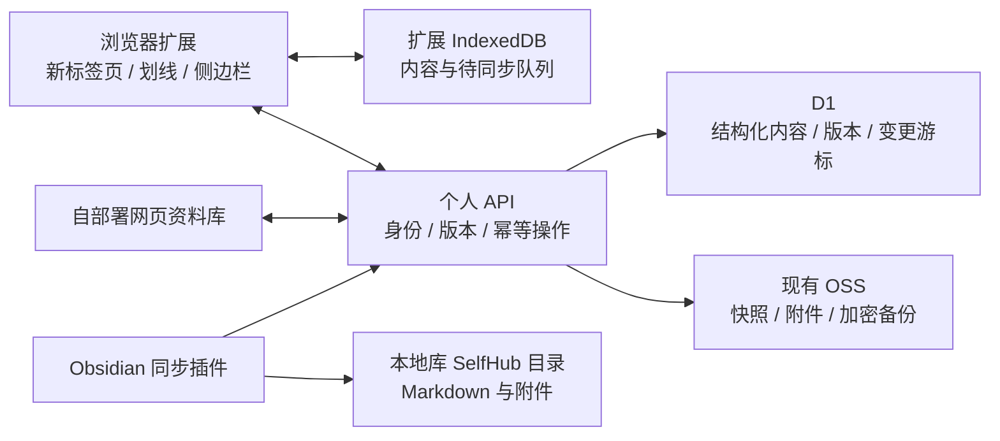

# Self-Hub：替代五彩与 GoTab 的产品设计

日期：2026-10-15。状态：设计提案，待分批实现和验收；没有修改应用代码、安装插件、迁移真实数据或创建云资源。

用户已确认：纯自用，未来考虑开放仓库；不再续费五彩，希望同时替代五彩与 GoTab。五彩最常用的是**电脑网页划线、批注、搜索和 Obsidian 同步**。笔记、网页收藏、项目资料仍是内容中心的主要积累方向。

本设计为当前主线，优先于旧路线图中“浏览器扩展后置”的安排。基础存储迁移与加密原则沿用[内容中心设计](2026-10-15-personal-content-hub-design.md)，执行任务见[替代实施路线](../../REPLACEMENT_PLAN.md)。

## 1. 产品与第一版范围

产品由一个完整网页资料库、一个 Chrome / Edge 扩展和一个小型 Obsidian 同步插件组成，共用内容模型和个人 API。浏览器扩展同时提供新标签页、网页划线与侧边栏；网页负责集中管理、阅读、整理与恢复；Obsidian 插件只负责把资料可靠写入本地库。

### 必须交付的替代能力

| 原工具 / 场景 | 第一版交付 | 完成依据 |
| --- | --- | --- |
| GoTab：新标签页 | 分组导航、文件夹、置顶、拖拽排序、搜索引擎选择、明暗主题、可选本地壁纸 | 日常链接完整迁入，离线可打开；不依赖原工具在线服务 |
| GoTab：工作入口 | 最近项目、快速笔记、待整理收件箱、进入完整资料库 | 新增和编辑结果可以找回、搜索与导出 |
| 五彩：网页划线 | 选中文字、浮动工具条、颜色、快捷键、修改与删除 | 支持范围内刷新 / 重开后可重新定位；保存失败可见 |
| 五彩：批注 | 对单条划线写想法、标签、项目归属，支持整页笔记 | 批注与正确划线关联，修改和删除可恢复 |
| 五彩：集中回看 | 网页列表、每页划线列表、普通内容全文搜索、来源跳转 | 搜索选中某条划线能直达并定位；定位失败仍能读原摘录 |
| 五彩：Obsidian 同步 | 增量同步到专用目录，按网页聚合划线与批注，保留个人补充 | 开着 Obsidian 时能自动拉取并落盘；中断重试不重复、不覆盖个人文字 |
| 五彩 / GoTab：迁出 | 旧数据导入预览、差异报告、原始备份保留 | 数量和字段覆盖可核对；无法还原的内容明确列出 |
| 资料安全 | 本地保存、失败队列、完整备份、独立金库 | 网络不可用不丢摘录；卸载或换设备前有可验证的外部副本 |

本轮不要求对齐所有装饰组件、天气热点、图片高亮、内置 PDF 划线、移动端微信原生采集、Safari / Firefox 插件或任意站点兼容。这些分别列为后续扩展，不能以“完整替代”名义暗示已经支持。

首发范围是桌面 Chrome / Edge 上可读取的普通 HTTP(S) 页面，包括已验证的技术文档、博客、新闻、代码仓库说明和普通中文文章。浏览器内部页、商店页、内置 PDF 阅读器、封闭 Shadow DOM 与未授权跨域 iframe 不作首版支持承诺。

## 2. 三种路线与选择

| 路线 | 优点 | 主要代价 | 结论 |
| --- | --- | --- | --- |
| 只增强网页版 | 复用现有界面，部署简单 | 无法直接在用户浏览的普通网站上提供划线入口 | 保留为完整管理端，单独使用不满足五彩替代目标 |
| 只做浏览器扩展 | 单机离线划线与新标签页可快速形成闭环 | 手机回看、独立资料库、跨设备与 Obsidian 持续同步都需额外连接 | 作为早期可用版本，保留本地模式 |
| 共享内核 + 扩展 + 网页 + 小型同步插件（推荐） | 收集、管理、回看、Obsidian 使用同一份资料；扩展各端可逐步实现 | 增加个人 API 和小型 Obsidian 适配器，需要端到端同步验收 | 目标架构，按里程碑逐步交付 |

初版不运营公共云账号体系。安装扩展即可本地使用；需要网页版同步与 Obsidian 自动同步时，连接用户自己的 API。自部署会有存储、请求和维护成本，不承诺永久免费。

## 3. 用户工作流

### 阅读网页

用户首次点击扩展按钮，在当前页启用划线。选中文字后出现颜色与批注入口；本地写入确认后显示已保存，联网同步状态单独展示。侧边栏列出本页所有划线，支持点击定位、批注、标签和关联项目。

想在此站点自动恢复划线时，用户单独授予该站权限。之后重新访问已授权页面，插件按 URL 身份和文本锚点恢复。权限撤销后停止自动注入，记录本身仍在资料库。

### 打开新标签页

第一屏是搜索、常用分组和链接。快速笔记、最近项目、待整理数量是轻量入口；完整笔记、原文、附件和凭证在打开时再加载。金库只显示锁定入口，不在新标签页展示密钥。

完整扩展包安装时注册新标签页覆盖。以后如提供“仅划线版”，通过不含 newtab 覆盖声明的独立构建发布；不设计一个实际无法修改 manifest 的“关闭覆盖”伪开关。

### 回看与 Obsidian

网页资料库按页面、标签、项目和时间组织摘录。搜索结果携带 pageId / annotationId，能打开原网页并交给已授权扩展定位；未安装扩展、网页失效或无权限时显示摘录与手动打开入口。

Obsidian 打开并启用配套插件后，拉取个人 API 的变更游标，生成或更新专用目录中的 Markdown。Obsidian 关闭时标记待下次同步，不能提示已写入本地库。

## 4. 资料模型与迁移身份

在原有公共内容字段基础上增加网页和批注实体，避免每条划线变成彼此无关联的笔记文件。

| 实体 | 关键内容 | 关系与约束 |
| --- | --- | --- |
| WebPage | pageId、原始 URL、匹配 URL、标题、来源、页面笔记、可选正文快照引用 | 一页可有多条划线；保留原链接，不以标题作身份 |
| Annotation | annotationId、pageId、摘录、颜色槽、批注、标签、项目、时间、锚点、revision | 每条稳定 ID；同页相同文字的不同位置可有不同 ID |
| Bookmark | bookmarkId、pageId / URL、分组、文件夹、排序、图标、显示名称 | 导航收藏与阅读资料可关联，删除导航卡不级联删划线 |
| Capture | captureId、pageId、提取正文、抓取时间、内容校验、附件引用 | 原网页摘录与正文快照分别保存，原页失效不影响已存摘录 |
| Project / Note | 既有项目 / 笔记模型 | 可引用网页与多条摘录，保留来源与跳转 |
| ImportBatch | 来源文件校验、来源记录 ID、字段覆盖、错误与操作记录 | 重复导入幂等；原始文件只留在用户数据区 |
| Device / Operation | 设备、权限范围、operationId、baseRevision、同步游标 | 设备可撤销；重试复用 operationId |

URL 匹配保留原地址，只对已确认不影响文章身份的追踪参数做规则化；SPA 的 hash 路由和必要 query 不盲目去除。canonical 链接仅作候选，多个 URL 是否合并要保留来源并允许撤销。

旧五彩记录映射到 Annotation，原 ID 存入 sourceId。只有摘录没有上下文的记录允许作为“历史摘录”导入；回原网页时未唯一匹配则标记待重新定位，不能随意高亮第一次出现的位置。

## 5. 划线引擎：保存与重新定位

### 保存的锚点

保存准确摘录、前后短上下文、规范化正文中的起止位置、可选 DOM 路径提示及正文版本摘要。引用 [W3C TextQuoteSelector / TextPositionSelector](https://www.w3.org/TR/annotation-model/#selectors) 的设计，应用字段独立版本化；第一版不宣称完整实现全部 Web Annotation 标准。

文本位置以一个定义固定、可映射回 DOM 的正文文本流计算，记录标准化算法版本。跳过脚本、样式、隐藏区域、输入框和 contenteditable，避免把用户正在输入的内容当成网页正文保存。

### 恢复顺序

1. 当前位置 / DOM 提示快速找候选，但必须核对摘录。
2. 用准确摘录和前后文寻找唯一文本区间。
3. 页面变化后对候选评分，只有达到明确阈值且有唯一候选时才重新附着。
4. 多个相同句子或内容已删除时标记 ambiguous / orphaned，保留摘录与批注，允许用户手动重新选择位置。

网页异步加载和 SPA 路由变化触发有界重试与局部检查，不能每次 DOM 变化都全文扫描。正文快照的锚点与原网页锚点分别维护，不假设提取后文本位置仍一致。

### 绘制与交互

优先验证 [CSS Custom Highlight API](https://developer.mozilla.org/en-US/docs/Web/API/CSS_Custom_Highlight_API) 在目标 Chrome / Edge、content script 与重叠范围下的表现，以不改动原网页文本节点的方式绘制。浮动工具条与批注 UI 使用隔离容器；交互原型需要验证颜色、点击命中、键盘、页面缩放和多段选区。

支持不足时提供明确的能力提示或经站点测试的降级方式，不通过不受控包裹文字节点承诺所有网站可用。跨节点选区、重复文本、换行空格、emoji、嵌套元素、两条重叠划线都是必测样本。

页面装饰与本地持久化状态分别管理：写入前可显示待保存标记，事务失败显示错误并保留摘录供重试；不能只画出颜色就认为资料已保存。

## 6. Chrome 扩展边界

采用 Manifest V3。构建产物包含 newtab、popup、side panel、content script、service worker 和所需脚本；共享的是源码与格式，不从远端下载 JS / WASM 来执行。[Chrome 远程代码规则](https://developer.chrome.com/docs/extensions/develop/migrate/remote-hosted-code)。

- `activeTab` / `scripting`：在用户明确触发后读取当前页和注入划线能力。
- `storage`：少量扩展设置；大量内容和队列使用扩展自身的 IndexedDB。
- `sidePanel`：集中本页划线与快速记录；不把整套后台塞入 popup。
- 可选站点权限：为用户选择的站点注册自动恢复脚本；首次安装不默认申请所有网页权限。
- 可选书签权限：用户选择浏览器书签导入时才申请；默认不改动原浏览器书签。
- 个人 API 的 host permission 按用户配置的服务器申请，配套服务校验身份与请求内容。

消息处理校验发送来源、tab / frame、页面 URL、消息类型和数据大小。content script 不接触云端长期密钥和金库主密码，也不成为可发往任意地址的通用代理。

MV3 service worker 随时可能停止，操作队列和同步状态写入持久化存储，通过可恢复任务唤醒；不能依靠全局变量、永久计时器或一直运行的后台页面。[Chrome 生命周期](https://developer.chrome.com/docs/extensions/develop/concepts/service-workers/lifecycle)。

## 7. 存储、个人 API 与部署



推荐沿用 Cloudflare Pages 托管网页，新增 Worker 个人 API、D1 与现有 OSS。D1 作为同步结构化资料的权威来源；OSS 存附件、体积大的正文快照与备份。浏览器 IndexedDB 是可离线工作的本地副本和未上传操作队列。

此前方案把数据库留到后期；现在浏览器、网页和 Obsidian 三端共享资料已成为明确需求，所以将 API 与 D1 提前到替代版的同步阶段。完整替代主线不同时维护“纯 OSS manifest 同步”和“API 同步”两套协议。纯本地版仍可独立使用与导出。

本轮不实现另一套 Docker 服务端。未来如果有离线服务器 / NAS 需求，在稳定的 API 合约之后再加 Node + SQLite 等适配器；不要求首版同时支持多种后端。

### 同步规则

- 本地写入资料与 outbox 在同一事务完成，分别展示本地成功、待同步、云端确认和失败。
- API 用 operationId 去重，以 baseRevision 检查更新；内容版本、当前指针、变更游标在数据库事务中一致提交。
- 基线不一致返回冲突，不无条件覆盖；保留客户端待提交版本，冲突解决后产生新版本。
- 客户端按服务器游标拉取变更；设备时钟只用于展示，不决定覆盖顺序。清理旧游标后提供重新取得基线的流程。
- 删除先产生可恢复标记；附件上传确认后才发布完整资料的云端可用状态。

### 设备授权与访问身份

网页管理入口通过 Cloudflare Access 验证所有者。扩展与 Obsidian 在网页管理端发起配对：默认 10 分钟有效的单次配对码绑定客户端挑战值，成功后发放可撤销、默认 12 小时有效且有作用域的设备凭证；服务端只保存设备凭证摘要。这些时效是第一版设计默认值，可由所有者配置。

管理端路由验证 Access 身份；设备同步路由由应用验证设备凭证。部署时明确区分两种路由的 Access 策略，不能把应用 token 当作 Cloudflare Access token，也不能为了插件联网关闭全部入口的鉴权。

Obsidian 默认只取得同步读取权限；扩展取得自身所需内容权限；金库不在普通同步权限内。跨域白名单只是附加限制，身份校验、设备撤销、请求校验和限流由 API 完成。云端长期密钥保留在服务端配置中。

首版设备访问凭证采用短时会话：扩展置于仅可信扩展上下文可访问的 session 存储，Obsidian 置于进程内存，重启后重新授权，离线资料仍可查阅。凭证不进入普通资料备份或 Vault 中会随 Remotely Save 传播的插件配置。长期免密留到可验证的设备安全存储方案之后，不把主密码或长期云密钥写入插件设置文件。

普通网页资料由私有服务端保存可读内容，不能把整个系统宣称零知识加密。金库及保密区域继续客户端加密，普通索引、侧边栏和 Obsidian 默认排除保密内容；需要导出保密资料时单独解锁并明确选择范围。

## 8. Obsidian 同步必须是真正落盘

推荐一个只承担同步与格式转换的配套插件，使用 [Obsidian Vault API](https://docs.obsidian.md/Plugins/Vault) 写入本地笔记；浏览器插件不直接假装拥有任意本地目录写入能力。

- 默认单向：Self-Hub → Obsidian；Obsidian 自己写的补充段落留在本地，不自动反向修改划线。
- 默认目录 `SelfHub/Clippings/`；每个 pageId 对应一个稳定文件名，改网页标题不生成重复文件。
- YAML 记录来源、pageId、标签和同步时间；正文分为系统管理的摘录 / 批注区与用户自由记录区。
- 单条摘录携带 annotationId 和来源跳转链接；排序稳定，重复同步不追加同样内容。
- 只更新已识别的管理区，用最后导出校验识别人为修改；管理区被改动时生成冲突文件 / 提示，不覆盖个人修改。
- 删除划线默认在管理区标记移除或归档；删除本地 Markdown 不反向删除源资料。是否重新生成由插件设置明确控制。
- 应用启动和手动同步可触发拉取；自动同步在 Obsidian 已打开且有网络时定期增量执行，持久化游标和错误状态。
- Remotely Save 可继续同步已生成的 Markdown。Self-Hub API 不直接改写它的 OSS 内部格式或接管现有五彩目录。

插件提供一键导出 Markdown / JSON 作为人工兜底，但手动导出不等于自动同步完成。Obsidian 关闭、设备离线或写文件失败时不能提前推进“已落盘”游标。

## 9. 五彩与 GoTab 的迁移

### 五彩：先保存可用的原始副本

五彩当前官方文档将划线导出、API 与同步列为 PRO 能力，迁移准备应放在当前权限仍可用时，不假设到期后权限不变。[会员说明](https://doc.wucai.site/account/)。

优先保留后台可导出的完整文件，以及已同步到 Obsidian 的独立目录副本。核对页面、划线、批注、标签与已剪藏正文的数量和字段。全文是否同步出来取决于原模板是否包含 mdcontent 等内容，不能把只有 URL 的文件当成全文备份。[五彩 Obsidian 同步说明](https://doc.wucai.site/sync/obsidian.html)。

导入器按真实文件样本确认格式，保留 sourceId、原文件和未识别字段。通过 JSON / 导出文件或 Markdown 恢复摘录与批注；缺锚点的记录标记历史摘录，缺颜色 / 日期时记录未知，不伪造。

现有 `wucaiClient.ts` 中 GET + Bearer 的抓取方式不应直接作为迁移依据。官方公开 API 描述的是生成的私有接口链接、POST + JSON，并有业务状态码；如需要临时在线迁移，应按[官方 API](https://doc.wucai.site/tools/api.html)单独验证。该接口不是新系统日常运行依赖，也不用于规避会员权限。

### GoTab：内容优先，布局按能映射的范围迁移

优先使用原始 JSON 备份，保留分组、文件夹、网址、名称、排序、搜索引擎以及可取得的图标 / 壁纸；文件结构以真实导出样本验证。HTML 书签作为链接兜底，不能承诺保留布局与自定义组件。[GoTab 迁移说明](https://www.gotab.cn/changelog/gotab.html)。

导入前预览映射、重复候选、丢失字段与资源失效情况，保留原始文件。主题、壁纸和图标仅迁移可用且用户可使用的资源，不复制原软件品牌、私有代码或付费素材。

### 迁移验收

来源数量与导入成功 / 跳过 / 失败数量能对上；对常用站点和批注做人工抽样；重复导入不复制记录；新系统完整备份能在空环境恢复；没有剩余“未知失败”才完成该批迁移。

## 10. 开发顺序与替代验收

| 阶段 | 交付 | 退出条件 |
| --- | --- | --- |
| R0：迁移准备 | 来源清单、导出说明、原文件保留、字段核对表 | 有可离线读取的旧资料副本与数量记录 |
| R1：底座与关键原型 | 既有保存 / 金库修复、IndexedDB；划线恢复 / MV3 / Obsidian 写入原型 | 原型通过重复文本、网页变化、后台停止与本地文件保护样本 |
| R2：本地替代版 | 分组新标签页、划线 / 批注 / 标签、侧边栏、本地搜索、导入导出 | 浏览器离线可日常使用；GoTab 常用入口完成迁入 |
| R3：网页与个人同步 | Worker API、D1、设备授权、outbox、网页管理、OSS 附件 | 两个客户端修改与失败重试可验证，无静默覆盖 |
| R4：Obsidian 与最终迁移 | 同步插件、旧五彩导入、稳定文件映射、恢复演练 | 划线 / 批注增量落入 Obsidian，个人补充与错误游标受保护 |
| R5：日常切换 | 真实站点验证、并行使用、导出恢复、卸载前检查 | 核心工作流连续 7 个实际使用日通过，旧工具不再是唯一功能或数据来源 |
| R6：后续扩展 | 全文剪藏、图片 / PDF、手机采集、更广浏览器、AI 整理 | 每项独立验证，不阻塞已确认的电脑替代范围 |

R0 是用户数据准备，不代表本轮已取得用户导出文件。R1 原型是单独验证工作，不在设计文档提交时创建空实现。开发按小批可运行结果交付，不把全部功能塞进一次重构。

### 需要验证的难点

- 标注：至少覆盖 30 篇代表页面；记录静态、异步、SPA、重复文字、代码块、跨节点、网页变化和权限拒绝结果。稳定页面场景必须可复现，内容删除场景应报告失锚，不追求错误附着的高成功率。
- 新标签页：断网可显示已存导航，首屏不下载全文和大附件；新标签页与采集功能单独测量。
- 可靠性：保存失败、worker 被停止、重启浏览器、重复消息、设备撤销、游标过期均有恢复路径。
- Obsidian：新建、改名、改批注、删除、重复拉取、用户改管理区、用户自由段落、关应用后重开等情况分别验证。
- 迁移：原始导出备份只读保留；未支持字段和历史失锚项能检索，不以“导入成功”掩盖丢失。

用户决定取消续费的时间；系统以独立数据、常用划线能力、真实 Obsidian 同步和备份恢复通过为替代就绪标准，不以界面相似或版本号作为依据。测试新标签页时使用独立浏览器配置保存旧环境，最终切换默认入口由用户选择。

## 11. 源码组织与开放仓库

建议逐步形成以下边界，先在现有 `src/` 中抽取稳定逻辑，不在本轮移动文件：

```text
apps/web/                完整资料库与管理端
apps/extension/          MV3 新标签页、划线、侧边栏与后台
apps/api/                个人 API、同步与设备授权
apps/obsidian/           本地 Markdown 同步适配器
packages/core/           类型、校验、版本、导入身份与同步协议
packages/anchoring/      DOM 文本锚定与恢复，和纯数据内核分开
packages/markdown/       按页聚合格式、稳定 ID 与管理区生成
packages/importers/      五彩 / GoTab / Markdown / 书签适配器
```

业务模型、导出与格式转换复用；浏览器 API、DOM、Worker 数据库和 Obsidian 文件系统分别封装。扩展各页面共用扩展自身的存储；网页和扩展通过显式同步共享内容，不能假定共用同一份 IndexedDB。

初版提供本地扩展包、自部署网页 / API 文档和 Obsidian 插件安装包；商店上架作为独立发布步骤。开放前完成示例数据分离、域名配置、许可证与依赖素材来源确认，不让仓库包含导出文件、Cookie、设备凭证或用户库内容。

## 12. 本次设计结论

主线已从“增加五彩连接器”变为“自己实现网页标注，并迁出五彩数据”；从“以后再考虑插件”变为“浏览器扩展是主要日常入口”。保留既有个人资料库与 OSS 投入，优先实现用户已确认的电脑划线、批注、搜索、Obsidian 同步和导航新标签页。

本次只提交设计和路线调整。划线恢复、个人 API、设备配对与 Obsidian 自动同步都需要真实实现和验收，不能把现有展示模块当成这些能力已经存在。
