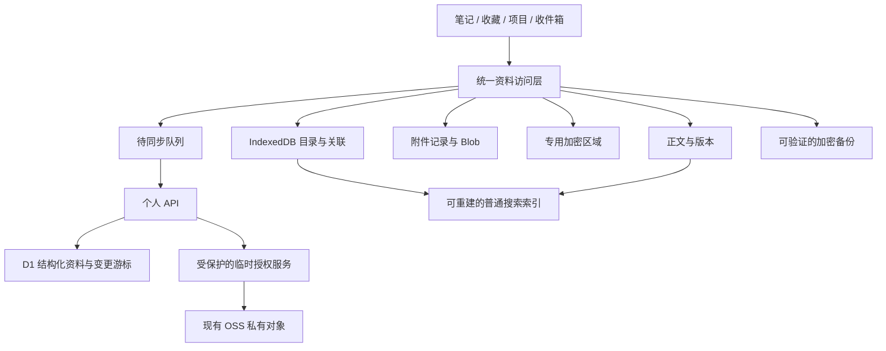

# 个人内容中心：扩展与存储设计

日期：2026-10-15。状态：供后续实现使用的规划草案；本次只写文档，尚未修改运行时模型、存储、页面或云资源。

已确认需求：项目纯自用，希望能长期保存更多内容；优先笔记、网页收藏和项目资料。图片、PDF、手绘与其他文件先作为这些内容的附件。执行阶段见 [ROADMAP](../../../ROADMAP.md)，任务见 [NEXT_STEPS](../../NEXT_STEPS.md)。

**后续设计决定**：用户已明确希望替代五彩和 GoTab，优先电脑划线、批注、搜索和 Obsidian 同步。完整替代版以[浏览器工作台替代设计](2026-10-15-browser-workspace-replacement-design.md)为准，个人 API / D1 已提前进入同步阶段；本文件保留通用内容、迁移、附件与加密约束。

## 1. 目标与使用场景

目标是让资料随手存入、逐步整理、可靠查回，并能迁出本站。第一条完整流程：把一段笔记和几个网页存入收件箱，整理进项目，关联部署信息，添加截图或 PDF，之后用搜索直接打开并导出整个项目资料。

保持单人工作流。新的主题先通过标签和集合表达；功能扩展时复用存储、搜索、附件与导入规则。公开主页、多人协作和远端自动任务各自独立评估。

## 2. 可选路径与推荐

| 路径 | 组成 | 适用场景 | 代价 |
| --- | --- | --- | --- |
| 本地资料库 | IndexedDB + 手工加密备份 | 先解决单设备容量与录入问题 | 跨设备搬运靠导出导入，需自行保留外部备份 |
| 本地资料库 + 现有 OSS | IndexedDB + 现有 OSS + 上传时使用的受保护临时授权服务 | 单机资料与独立远端副本 | 纯对象同步需要另行解决并发与多客户端状态，不作为当前完整替代版主线 |
| 个人 API + D1（当前完整替代版推荐） | 本地副本 + Worker API / D1 + OSS 附件 / 备份 | 浏览器、网页和 Obsidian 共用结构化资料 | 多一套服务、部署、数据迁移与故障处理 |

先交付本地资料库和扩展，再通过个人 API / D1 实现三端同步，复用 OSS 保存附件与备份。当前不同时维护多种后端，不承诺任何服务的免费额度或长期费用。

IndexedDB 支持异步、带索引的结构化数据与 Blob 存储，适合逐步替代现有整份 JSON 的读写；它仍受浏览器配额与清理机制影响。[MDN IndexedDB](https://developer.mozilla.org/en-US/docs/Web/API/IndexedDB_API)、[存储配额](https://developer.mozilla.org/en-US/docs/Web/API/Storage_API/Storage_quotas_and_eviction_criteria)。

## 3. 内容模型：公共目录与类型详情

下列名称是设计约定，不是已实现的 TypeScript API。新增时先定义每种详情的运行时校验与迁移，不引入任意 JSON 字段来绕过类型约束。

| 层次 | 字段 / 类型 | 说明 |
| --- | --- | --- |
| 公共目录 | id、type、title、summary、createdAt、updatedAt | 稳定 ID；改名不改身份；列表默认只加载这些摘要 |
| 整理信息 | collectionId、tags、projectIds、pinned | 一个主集合、多个标签；条目可关联多个项目 |
| 生命周期 | state、deletedAt | state 为 inbox / active / archived / trash；彻底删除另设显式流程 |
| 来源 | provider、sourceId、sourceUrl、importBatchId | 手工、书签导入、五彩、有道、Obsidian 等来源；支持溯源与去重 |
| 版本 | schemaVersion、revisionId、parentRevisionIds | 格式升级与内容更新分别记录；初始版本无父项，普通更新一个父项，合并多个父项 |
| 笔记详情 | bodyMarkdown、可选模板类型 | 长文、片段、日记、阅读记录先共用此类型 |
| 收藏详情 | url、canonicalUrl、readingState、个人批注 | 保留原始 URL；规范化只用于候选去重 |
| 项目详情 | description、status、repoUrls、homepageUrl、可选日期 | 聚合相关资料，项目归档不删除资料 |
| 文件资料详情 | attachmentIds、description | 需要独立管理原始文件时提供资料入口 |
| 现有资产详情 | server、reminder、checkin、handwriting | 逐步适配，保留原类型的专有字段 |
| 附件关联 | contentId、attachmentId、purpose、顺序 | 一份原件可被多条资料引用，关联独立于文件名 |

普通资料默认使用私有存储与访问控制。金库继续使用独立的 secret 实体；普通项目只保存不含值的 secret 引用。密码、私钥、令牌及敏感备注不混入普通摘要、标签与全文索引。

需要额外客户端加密的笔记 / 文件放入保密区域，其标题、来源、正文、附件说明一起加密。锁定目录仅保留不泄漏名称的 ID、必要版本信息和加密标记；解锁后在内存中还原展示和搜索。

## 4. 分层存储与数据流



| 存储区 | 保存内容 | 清理原则 |
| --- | --- | --- |
| localStorage | 主题、少量视图偏好、迁移完成标记 | 不保存正文、原件、长期密钥或主密码 |
| IndexedDB 目录 | 内容摘要、关系、普通标签、来源、同步状态 | 属于资料的一部分，需要备份 |
| IndexedDB 正文 | 普通正文、必要版本；保密区域为加密载荷 | 未确认远端与备份前不自动清理唯一副本 |
| IndexedDB 文件区 | 附件元信息、原件、缩略图 | 派生缩略图可重建；原件按已验证副本规则管理 |
| IndexedDB 操作队列 | 保存 / 上传 / 删除意图、重试与错误 | 成功确认后压缩历史，保留冲突所需信息 |
| API / D1 | 结构化资料、版本、幂等操作与同步游标 | 独立备份；客户端通过游标取得变更 |
| OSS | 附件原件、体积大的快照、备份对象 | 前缀隔离；结构化资料的同步权威来源为个人 API / D1 |
| 搜索索引 | 普通标题、标签和已缓存正文的检索数据 | 可重建；保密内容不写入此持久化索引 |

一次本地变更在同一事务内更新资料与操作队列，完成后显示“本地已保存”。上传和下载在事务外执行，再用短事务提交状态；不能在 IndexedDB 事务中等待网络。远端确认前显示“待同步”，失败保留错误和重试入口。

`navigator.storage.estimate()` 用于估计用量；可申请 `persist()`，请求可能获准或被拒绝，不能把它当成备份保证。[MDN persist()](https://developer.mozilla.org/en-US/docs/Web/API/StorageManager/persist)。

## 5. 附件与对象目录

附件元信息至少保存：稳定 ID、原始名称、MIME、原始大小、校验算法与值、存储对象引用、是否加密、本地 / 云端状态。业务 ID 与内容校验值分开：重复文件可以提示复用，不能因同名或同校验值擅自删除用户资料。

建议在现有 Obsidian 前缀之外使用单独的 `self-hub/` 前缀。以下为对象副本 / 备份布局示意，records 和 indexes 不作为 API / D1 之外的第二套权威目录：

```text
self-hub/
  records/<content-id>/<revision-id>.json
  blobs/<attachment-id>/<revision-id>.bin
  indexes/<device-id>/<index-revision>.json
  backups/<backup-id>/...
```

对象键使用不含个人标题的 ID。普通 Markdown 需要兼容 Obsidian 时，通过显式的导出 / 适配器写入原来的库；先确认 Remotely Save 的路径、附件链接及加密设置，不直接假设两种存储格式兼容。

附件保存先确认本地原件落盘，再允许生成对其引用。上传原件并校验后，资料才标记云端可用。目录已同步但原件尚未到达时，显示待传输；不能显示为空文件或完整成功。

默认单文件上限 20MiB 是第一版的产品限制，可调。先支持小型文档和图片，后续根据真实文件需要增加分片与断点续传。敏感大文件在实现经验证的分块加密前保持大小限制；避免一次性把整个文件与 Base64 副本都放入内存。

PDF、图片可预览；不支持预览的类型仍可完整下载。HTML 和 SVG 等主动内容默认下载或隔离展示，不插入主页面执行。原件与缩略图分开，释放不用的 Object URL。

## 6. 导入与统一收集

每批导入遵循：读取来源 → 解析并校验 → 预览分类与重复候选 → 保存条目和来源标识 → 输出成功 / 跳过 / 失败报告。失败条目可重试，导入批次可撤销；撤销只处理本批新建或可逆变更，不删除之后被用户编辑的资料。

- **剪贴板 / 手工**：先可靠保存普通原文；发现密钥时走专用加密录入，不复制到普通说明。
- **书签 HTML**：保存标题与原链接，尽量保留文件夹来源；同 URL 合并前给出选择，业务参数不自动丢弃。
- **Markdown 文件夹**：保留相对路径、正文与附件映射；安全处理路径穿越、重名、缺失附件和编码错误。
- **五彩 / 有道**：优先支持用户提供的导出文件；API 的鉴权、字段、分页和浏览器可达性验证通过后再标记已连接。
- **Obsidian**：正文懒加载、列表完整分页；原生库中的删除和覆盖需明确确认，默认先只读导入。

网页全文抓取受目标站与浏览器访问能力影响。第一版保存用户输入的批注和选中文本，后续再提供受控抓取或扩展入口；收藏链接本身不表示网页正文已备份。

## 7. 查找与整理

共同支持集合、标签、项目关联、置顶、归档和回收站。搜索以 `type + id` 返回结果，加载所需正文后定位具体记录；找不到、尚未缓存或需要解锁时分别处理。

先索引普通标题、标签、摘要与已缓存正文，再增加中文分词和拼音能力。大批建索引在后台或 Web Worker 分批执行；索引损坏可重建。第一版附件只检索文件名与说明，PDF 文字 / OCR 是后续任务，提取失败不能影响原件保存。

## 8. 同步与并发修改

第一步是可靠本地保存和手动备份；只有错误恢复流程完整后才启用自动同步。完整替代版通过个人 API / D1 保存版本和变更游标，每个版本有唯一 revisionId、parentRevisionIds 与 operationId；重试同一操作复用这些 ID，并以 baseRevision 校验更新。

多设备给同一父版本提交不同子版本时构成分叉，两份都保留并标记冲突。合并或选取后生成引用相关父版本的新版本。时间戳只用于展示，不能采用最后更新时间静默覆盖正文。

客户端根据 API 游标读取变更；服务端事务保持内容版本与游标一致。不要把一个 OSS 共享 manifest 的无条件覆盖作为同步正确性的依据。读取原生 Obsidian OSS 目录或对象备份时仍需按 continuation token 分页。[OSS ListObjectsV2](https://www.alibabacloud.com/help/en/oss/developer-reference/listobjectsv2)。

ETag 是对象版本校验依据之一，不能假设它始终是文件 MD5，也不能把“读取 ETag 后无条件 PUT”视为原子条件写。对象写入保留恢复能力；结构化资料条件更新使用当前设计中的 API / D1 事务。

回收站和删除作为版本变更同步。离线旧设备重连需尊重删除标记；永久清理前检查所有引用、未解决分叉、同步设备状态与备份保留策略，长期离线设备重新加入时需要重新同步基线。

## 9. 访问身份、密钥与保密区域

私人站点与 API 受同一身份策略保护；API 必须验证请求身份和授权范围，不能只依赖前端隐藏按钮。后续公开站点从明确选择的普通资料生成独立发布产物，不访问私有前缀。

长期 OSS 密钥放在受保护服务端，浏览器仅取得限定前缀、动作与时效的临时授权；服务端校验身份后才发放。浏览器 SDK 与临时凭证的推荐方式来自[阿里云 Browser.js 文档](https://www.alibabacloud.com/help/en/oss/developer-reference/faq)；API 身份校验参考 [Cloudflare Access JWT 验证](https://developers.cloudflare.com/cloudflare-one/access-controls/applications/http-apps/authorization-cookie/validating-json/)。

金库保留客户端加密。设计采用随机数据密钥加密载荷、主密码派生密钥包装数据密钥的方式，载荷记录算法与版本；每次加密使用新的 IV。密码更换先校验旧密码并生成可恢复副本，再更新包装信息。KDF 参数通过当前设备性能与安全要求确定，并写入格式，不能只改常量导致旧密文不可读。

普通字段和保密载荷有不同的访问边界，开发中需要逐项列出标题、摘要、来源、附件及文件名是否敏感。保密内容只在解锁后的内存索引中搜索，锁定后清空编辑器、预览、缓存与临时资源。客户端加密不能防御解锁时已获得同源执行权限的恶意脚本，不使用“银行级”“绝对安全”等描述。

AI 为可选整理助手。发送前展示范围与目的地，保密内容默认排除；生成标签、摘要和日期作为建议，不替换原文或自动创造未经确认的到期时间。

## 10. 备份、恢复与文件迁出

区分三种操作：

| 操作 | 内容 | 用途 |
| --- | --- | --- |
| 普通导出 | 选中笔记 Markdown、收藏 JSON / HTML、项目清单 | 可读迁出；明确是否含附件及未加密的个人内容 |
| 完整备份 | 全部资料、关联、原件、所需版本及加密恢复信息 | 在干净设备恢复；有缺失原件时不能宣称完整 |
| 增量同步 | 当前工作集的新版本和待同步操作 | 多端连续使用，不能代替历史备份 |

完整备份清单记录格式版本、条目和附件计数、逐文件校验值、生成时间、内容范围、KDF 与解密所需信息。默认完整加密，包含机密内容和配置；不保存明文主密码。恢复先验证结构、密码、附件可用性和校验值，在隔离区导入并预览，成功后切换；保留导入前快照。

只含元信息或依赖外部对象链接的导出称为资料清单，不能称为完整备份。云端同步删除不会直接清掉历史备份；保留周期由用户按用量设置，正式清理前可预览影响。

## 11. 旧数据迁移和模块边界

1. 从 `self_hub_data_v2` 读取旧 JSON，保持不变，保存迁移前快照。
2. 校验各集合，映射类型并保留旧 ID、时间、来源、标签；补充版本与新的关联字段。
3. 把手绘 Data URL 转为附件 Blob；校验原件大小与引用。不能解密的数据只保留原密文并标记待解锁处理。
4. 在新存储中核对每类数量、正文内容、附件校验值和引用；生成迁移报告。
5. 事务成功后标记新存储可用。失败保留旧版本，重复执行跳过已迁移记录。
6. 用户确认并完成新格式恢复演练后，才提供清理旧副本入口。

局部演进时可由 `src/data/` 管本地事务与迁移、`src/domain/` 管内容类型和校验、`src/services/` 管外部服务；完整替代版逐步抽取为替代设计中的 apps / packages 边界。两者是同一次渐进拆分，不同时维护两套核心实现。本轮不创建空模块或批量移动文件。

现有设置先加密迁移；数据无法解密时不自动重置金库。将来更换对象存储或替换 D1，通过存储 / 同步适配器实现，公共 ID、导出格式和原件仍可使用。当前数据库选型参考 [D1 官方说明](https://developers.cloudflare.com/d1/)。

## 12. 验收与本轮范围

- 第一轮内容流程：收集 → 本地确认 → 分类 / 项目归属 → 搜索定位 → 修改 → 导出 → 恢复。
- 故障流程：存储配额不足、坏备份、错密码、网络错误、云端拒绝、分页、中断迁移、重复导入与离线冲突。
- 附件流程：同名不同内容、原件上传失败、共享引用、缓存清理、缺失原件的备份提示。
- 容量与时间目标采用 [ROADMAP](../../../ROADMAP.md) 中明确标注的验收数据集，不宣传未经测量的性能。

本轮交付为 README、路线图、本设计和下一批任务。功能实施从 N01 开始，存储迁移单独验收；文档提交不代表对应功能已完成或云资源已经创建。
