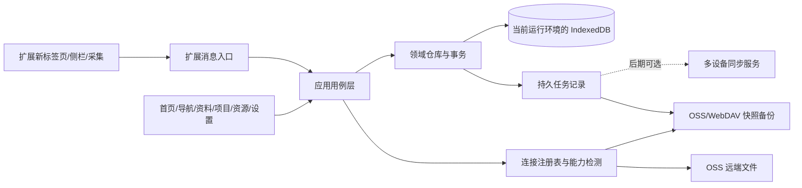

# Self-Hub 综合站重设计方案

日期：2026-10-18 ｜ 状态：完整评审稿，尚未实施 ｜ 基线：本次检查时 HEAD `a1b8c37`

配套文档：[详细开发文档](../../SELF_HUB_DEVELOPMENT.md) · [分阶段任务与验收](../../SELF_HUB_IMPLEMENTATION_PLAN.md) · [已确认产品约定](../../../PRODUCT.md)

## 1. 这次要把系统改成什么

把 Self-Hub 做成一个每天打开就能直接做事的个人综合工作台：打开常用网站，收集网页与想法，整理和查找资料，推进项目，管理服务器、凭证和到期事项。

用户已确认：快捷导航、资料工作台、综合个人控制台三个方向全部需要。它们是同一产品的使用场景，不设计成三个互斥版本，也不靠关闭其中两类来换取简洁。

设计原则：

- 日常按任务进入：打开、记录、查找、整理、处理提醒。
- 每份数据有明确归属；不同页面可以展示同一条记录，不额外复制。
- 配置先说明“能帮你完成什么”，随后才出现服务商和技术字段。
- 连接信息、用途、任务状态分别表达。
- 每个空状态和失败状态都提供可执行的下一步。
- 高频入口直接可见，低频细节逐层展开，原有能力都有去处。

## 2. 现状诊断与依据

本稿依据实际代码和本地页面检查，不把历史文档中的“已完成”直接当作当前运行结果。页面检查使用独立本地开发地址和初始示例数据，没有读取或改动真实账户配置。

| 问题 | 仓库依据 | 对使用的影响 | 改版要求 |
| --- | --- | --- | --- |
| 11 个一级模块平铺，且名称抽象 | `src/components/Sidebar.tsx:77` | 找不到入口，也看不出功能关系 | 导航分为日常、管理、设置，使用直白名称 |
| 顶栏和侧栏重复提供搜索、AI、新建、设置 | `Sidebar.tsx`、`Navbar.tsx` | 视觉拥挤，主操作不明确 | 桌面只保留一套全局操作；手机复用同一动作定义 |
| 首页主要展示网站与空的运维卡片 | `views/DashboardOverview.tsx` | 已有笔记不突出，空模块反复要求配置 | 首页展示真实近期工作、常用入口和到期事项 |
| 功能开关默认全部开启，另有固定核心模块 | `src/lib/features.ts:35,86` | 关闭开关仍不等于用户理解系统 | 改为导航偏好与能力状态分离；默认合理组织 |
| 一个“多平台数据互通”承载远端文件、五彩、有道等不同用途 | `views/DataInteropView.tsx` | 阅读资料前先被技术概念拦住 | 阅读入口进资料库，连接设置统一归设置 |
| 字段填写即可自动启用部分连接 | `src/lib/integrations.ts` | 填到一半就影响后台行为 | 先保存连接，再按用途明确启用任务 |
| 表单失焦保存，开关即时保存，底部“保存配置”仅确认关闭 | `IntegrationCard.tsx:44`、`SettingsModal.tsx:148` | 不清楚取消是否有效、是否真正保存 | 连接表单明确保存/取消，通用偏好即时保存并反馈 |
| 连接“已配置”主要依据字段，不是实际检测 | `IntegrationCard.tsx:24` | 错密钥也可能给人配置成功的印象 | 未测试、测试通过、失败、已暂停分别展示 |
| 只配 WebDAV 的自动备份触发条件仍依赖 OSS | `src/hooks/useCloudBackup.ts:72` | 手动可备份，自动可能不运行 | 统一备份目标解析，手动与自动共用 |
| 应用与扩展各自保存、各自同步 | `extensionBridge.ts`、`extension/sync/sync-manager.js` | 双写、两套目录、恢复选择困难 | 分阶段统一扩展内数据所有权与备份执行者 |
| 应用把收藏和批注整集合镜像给扩展 | `extensionBridge.ts:43` | 存在覆盖扩展新增记录的风险，需专项回归 | 迁移前双边取证，改用可去重的操作导入和共享存储 |
| localStorage 整包为主，IndexedDB 异步镜像 | `src/lib/storage.ts:255` | 保存确认、容量和恢复语义不一致 | 第二阶段以事务提交的 IndexedDB 为本地事实来源 |
| 五彩/有道能力与界面预期不一致 | `wucaiClient.ts`、`youdaoClient.ts` 与当前页面接线 | 用户填好凭据仍可能拿不到新内容 | 按实际支持标注“导入”“缓存”“可拉取” |

上述风险中，WebDAV 触发条件和保存按钮语义已经由代码确认；双边覆盖的影响范围需使用脱敏数据专项复现，不在此声称真实资料已丢失。现有云备份凭据剥离是固定字段处理，也不能解释为任意笔记、请求头或说明文字都自动脱敏。

## 3. 三种改版路径及决定

| 路径 | 做法 | 收益 | 成本与局限 |
| --- | --- | --- | --- |
| A. 整理现有界面 | 改名、分组、减少空卡片 | 改动小，可快速缓解 | 不能独立解决配置生效和双数据源问题 |
| B. 统一工作台，分阶段替换底座（推荐） | 先统一导航、任务和设置，再统一存储与扩展，最后按需增加真正多端同步 | 各阶段可交付，原功能可保留 | 需要严格划定过渡适配层和退出条件 |
| C. 全量重写并立即引入服务端 | 同时重写界面、数据、扩展和同步 | 最终架构统一 | 首次交付慢，迁移与回归范围最大 |

本稿完整展开 B。它是待评审建议，不把本轮选择“都需要”解释为用户已批准全部技术细节。

## 4. 新的信息架构

```text
Self-Hub
├─ 首页                    常用网站 / 快速记录 / 继续工作 / 今日事项
├─ 快捷导航                分组网站、搜索引擎、排序、导入
├─ 收件箱                  尚未整理的文本、网页、剪藏
├─ 资料库                  笔记、网页、批注、手绘、附件、远端笔记库
├─ 项目                    项目资料、关联资源、决策和待办
├─ 提醒                    到期、续费、周期事项
├─ 资源与安全
│  ├─ 服务器               主机、连接命令、HTTP 检测
│  ├─ 域名与订阅           域名、订阅、证书、到期与管理入口
│  └─ 凭证金库             解锁、查找、复制、关联
├─ 工具                    签到与执行记录、手绘入口
└─ 设置                    使用偏好、连接与任务、备份、设备、安全、维护
```

桌面导航把“首页—提醒”作为日常组，“资源与安全、工具”作为管理组。管理组默认可见，服务器/金库为二级入口；可把任意二级入口固定为常用项。设置固定在底部。只在收件箱和待处理事项上显示需要行动的计数，不给每个入口挂总数。

顶栏只有：当前页面标题、全局搜索、一个“新建”按钮。主题、AI 和解锁按上下文出现；金库已解锁时可有低干扰状态入口。桌面不同时渲染两套可见全局按钮。

旧入口映射：

| 当前名称 | 新去向 | 保留能力 |
| --- | --- | --- |
| 仪表盘总览 | 首页 | 常用网站、最近资料、提醒、资源摘要 |
| 网站与工作台 | 快捷导航 | 网站分组、访问、导入、编辑与排序 |
| 统一收件箱 | 收件箱 | 暂存、分类、转笔记、收藏、关联项目 |
| 深度知识文档 | 资料库 → 笔记 | 本地编辑、预览、草稿 |
| 多平台数据互通 | 资料库 → 来源；设置 → 连接与任务 | OSS 文件树、阅读、写入、索引与来源导入 |
| 自研项目空间 | 项目 | 项目信息、资料引用、资源和决策 |
| 自研部署与主机 | 资源与安全 → 服务器 | 主机信息、SSH 命令、HTTP 检测 |
| 加密安全金库 | 资源与安全 → 凭证金库 | 加密、解锁、复制、锁定 |
| 倒计时与续费 | 提醒 | 到期列表、续期、完成、周期 |
| 自动化与打卡 | 工具 → 签到 | 手动执行、打开目标、历史；定时另行启用 |
| 交互手绘白板 | 资料库 → 新建手绘；工具快捷入口 | 绘制、撤销、保存 PNG |

## 5. 首页：打开就知道下一步

按任务安排四块内容，1280×800 下前三块应可见主要内容。

1. **快速入口**：8–12 个置顶/常用网站，分组切换，站内/外部搜索明确区分。
2. **快速记录**：一行输入与“记录”按钮，支持文本或 URL；默认存收件箱，不强迫先选类型、项目和云服务。
3. **继续工作**：最近编辑/阅读的 6 条资料，显示类型、来源、更新时间和项目；从之前的位置继续。
4. **待处理事项**：7 天内提醒、收件箱待整理、失败任务；无事项时显示简短完成状态。已处理项不继续占位。

运维摘要在存在服务器或凭证数据时显示：待检查主机、快到期资源、金库锁定状态。不要无检测记录却显示“在线”，不要显示凭证预览或说明片段。首页模块允许排序、折叠和隐藏；完整功能依旧可从导航进入。

新用户首页只出现：添加常用网站、记录第一条内容、导入旧资料三个具体行动。示例数据必须在显式“体验示例”中创建，并可整批撤销，不污染正式库。

### 首页文字线框

```text
┌───────────┬────────────────────────────────────────────────────┐
│ Self-Hub  │ 首页                    搜索所有内容…      ＋新建   │
│           ├────────────────────────────────────────────────────┤
│ 日常      │ 常用网站                              管理全部 →   │
│ 首页      │ GitHub   邮箱   云控制台   文档   ……                 │
│ 快捷导航  │                                                    │
│ 收件箱 3  │ 随手记点什么或粘贴链接……                  [记录]    │
│ 资料库    │                                                    │
│ 项目      │ 继续工作                         今天要处理         │
│ 提醒   2  │ 部署手册 · 笔记 · 项目A            域名 3 天后到期    │
│           │ 文章批注 · 网页 · 学习             3 条内容待整理     │
│ 管理      │ 设计草图 · 手绘                    1 项备份需处理     │
│ 资源与安全│                                                    │
│ 工具      │ 资源摘要（有数据时显示）                            │
│           │ 2 台主机未检查              金库已锁定 [解锁]       │
│ 设置      ├────────────────────────────────────────────────────┤
│           │ 已保存在此设备 · 最近备份 10:30 · [查看详情]         │
└───────────┴────────────────────────────────────────────────────┘
```

此为结构线框，不是已实现页面或已确认的视觉高保真稿。

## 6. 每个业务页面怎样用

### 6.1 快捷导航与新标签页

- 默认显示置顶和分组网站；网站以名称和域名识别，访问次数放详情。
- 单击打开；编辑、移动、复制链接、删除在明确菜单内，不与打开动作混用。
- 新建只要求名称和 URL；分组、图标、标签可后补。
- 分组可拖拽，也提供“上移/下移/移动到”键盘替代操作。
- 外部搜索有引擎标签，站内搜索有“在我的资料中搜索”提示，不能意外把私人查询发送到搜索引擎。
- 新标签页显示常用网站、快速记录和少量今日事项；“打开完整工作台”进入同一扩展包内应用。
- 新标签页和应用的收藏在扩展环境中共用仓库；独立托管网页的共享边界见第 10 节。

### 6.2 收件箱

- 先记录，再整理。列表显示内容摘要、来源、时间、处理状态。
- “保存为笔记”“加入收藏”“关联项目”“归档”给出具体去向。
- 转换操作提交成功后才标为已处理，保存目标 ID，重复操作打开原目标而不重复创建。
- 批量处理先预览数量与去向，失败项目保留并解释原因。
- 本地规则分拣是辅助操作；云端 AI 在主动开启后才可使用，结果先预览再入库。

### 6.3 资料库

- 默认是全部资料列表，筛选：类型、项目、标签、来源、归档状态。
- “来源”是本机、网页采集、OSS 笔记库、五彩导入、有道导入；服务商不是一级导航。
- 左侧筛选/目录，中间列表，右侧阅读或编辑；手机列表与详情分屏切换。
- 笔记、网页与批注、手绘、附件按各自详情呈现，共用查找和关联能力。
- 同一网页的多条批注聚合为一页，显示来源 URL 和定位是否成功；失锚批注保留原文，不能挂到错误位置。
- 远端 OSS 文件默认明确标记“远端文件”；已缓存、未下载、保存中、冲突分别表达。连接中断时不能显示空正文冒充加载成功。
- 搜索声明覆盖范围，例如“本机资料 + 已建立索引的远端正文”；未索引的文件不能声称全文搜索完备。
- 手绘保存成为资料条目并引用图片附件；不要求用户理解 Base64 或存储桶。

### 6.4 项目

- 概览包括项目目标、当前状态、仓库/部署链接、最近资料、关联资源、近期提醒与决策。
- 关联是引用，不复制原笔记、收藏、服务器或凭证。
- 删除项目可选择归档或移除项目关联；不得级联删除独立资料和服务器。
- 凭证关联仅保存 ID；锁定时只显示受控的名称和“需解锁”，不解密给项目搜索。

### 6.5 资源与安全

服务器页：列表优先显示名称、环境、地址、检测结果与时间、到期时间。详情提供复制 SSH 命令、打开控制台、关联项目、相关凭证和提醒。浏览器中的检测名称是“HTTP 可达性”，TCP/SSH 监控和全天候告警不属于已具备能力。

金库页：进入时显示锁定界面与用途说明；解锁后可检索、复制和编辑。创建凭证要求主密码已建立。明文只能在明确查看/复制的上下文解密；锁定要清除详情、搜索缓存和全局状态中的明文。密码忘记时说明可用的加密备份恢复路径，不提供不存在的重置解密承诺。

### 6.6 提醒与签到

- 提醒默认显示逾期、7 天内、之后三组；完成与续期语义分开，续期展示新的日期。
- 日期按用户本地日历处理；不通过增加固定 30 天来模拟“每月”，月末和闰年有明确规则。
- 服务器/域名/订阅提醒引用对应资源，避免多个页面维护同一个到期时间。
- 网页版注明“页面打开时检查”；扩展注明“浏览器运行且通知权限可用时后台提醒”。不承诺关机后提醒。
- 签到区分“执行 HTTP 请求”和“打开页面手动完成”。打开 URL 不等于签到成功。
- 自动执行默认关闭；每项任务显示执行方式、上次结果、下次运行条件和暂停入口。

## 7. 设置中心：从目的到连接

设置改为独立页面，支持地址直达和返回原页面，避免长表单挤在弹窗里。

| 设置页 | 用户要完成的事 | 核心内容 |
| --- | --- | --- |
| 概览 | 判断系统是否可用、下一步做什么 | 本机保存、备份、扩展、笔记库、AI 的真实状态与行动 |
| 使用偏好 | 调整工作台 | 首页区块、常用导航、主题、搜索引擎、显示密度 |
| 连接与任务 | 接服务并指定用途 | 连接列表、连接详情、任务绑定、测试结果 |
| 数据与备份 | 保护或搬迁数据 | 备份目的地、加密包、恢复预览、覆盖范围、回收站 |
| 浏览器与设备 | 管理扩展和运行环境 | 本机模式、采集权限、新标签页、通知；后期配对设备 |
| 隐私与安全 | 控制解锁和内容外发 | 主密码、设备信任、AI 发送预览、日志脱敏 |
| 高级与维护 | 排查问题 | 索引、容量、任务记录、诊断导出、迁移报告、重置 |

### 7.1 一次配置的完整流程

以“为综合站建立自动备份”为例：

1. 选择“备份我的数据”。先解释备份覆盖本机哪些资料、远端附件是否包含、恢复需哪些密码。
2. 选择 OSS 或 WebDAV，填写连接信息；高级路径放折叠区，提供最终写入位置预览。
3. 点击“测试连接”：检查认证和目标目录权限，执行隔离的测试对象写入/读回/清理；不能改业务文件。
4. 展示结果：“可读取、可写入；尚未保存配置”。若测试失败，保留草稿和逐项修复建议。
5. 点击“保存并启用自动备份”；只有事务提交成功才显示已启用，并立即创建首次备份任务。
6. 首次备份完成后显示“上次备份时间、包含条目数、缺失附件数、查看报告”。

单独创建通用连接时，主按钮为“保存连接”，默认不启动任何任务。保存后可选择“用于整站备份”“用于远端笔记库”等用途。用途共享连接 ID，凭据只维护一份。

### 7.2 三类配置各自保存

| 配置类型 | 保存行为 | 退出行为 |
| --- | --- | --- |
| 主题、密度、首页排序等偏好 | 操作即保存，成功反馈，失败还原 | 无额外保存按钮 |
| URL、账号、密钥、路径等连接草稿 | 明确“保存”“取消”；测试不等于保存 | 有修改时提供继续编辑、放弃、保存 |
| 启停备份/AI/自动任务 | 对已保存配置明确启用/暂停，展示影响 | 不借由填写字段自动启用 |

用户在未保存的新草稿上开启任务时，必须提交同一草稿版本并完成用途绑定；不能把旧凭据用于新路径，也不能把修改一半的草稿提交给定时任务。

### 7.3 状态词汇

连接状态：未填写 → 草稿 → 已保存待测试 → 检测中 → 检测通过 / 检测失败。检测结果绑定配置版本，修改地址、密钥、路径立即变为待测试。

用途状态：未启用 / 已启用 / 已暂停 / 当前环境不支持。

任务状态：等待 / 运行中 / 成功 / 失败 / 有冲突 / 已取消。最近成功时间和最近失败原因可同时显示，不以“已配置”覆盖失败。

用户文案示例：“连接已保存，尚未测试”“已测试可写；自动备份未启用”“本机已保存，云端备份失败，点击重试”“普通网页无法使用此连接；可在扩展中执行”。

### 7.4 不同服务该做什么

| 服务/能力 | 改版中的明确用途 | 默认状态 |
| --- | --- | --- |
| 本机存储 | 基础使用、草稿、搜索、离线数据 | 可直接使用 |
| OSS | 远端 Markdown 文件/附件；也可作为备份目的地 | 连接与用途分别配置 |
| WebDAV | 整站备份目的地 | 需测试环境可达性后启用 |
| Obsidian | 现阶段读写远端文件、导出 Markdown；后期插件增量写本地库 | 不伪装成当前已完成的双向同步 |
| 五彩/有道 | 导入历史内容；真实 API 拉取达到验收后才开放 | 未接通的拉取不显示“已同步” |
| 云端 AI | 用户主动调用的分类/提炼辅助 | 默认关闭；本地规则可用 |
| 扩展 | 新标签页、采集、页面定位、浏览器后台任务 | 本机安装后可用 |
| 多设备同步 API | 后期可选能力 | 第一、二阶段不需要部署 |

## 8. 首次与已有用户引导

新用户：欢迎页只说明三类用途均可用；直接进入工作台。推荐完成三个可跳过任务：添加常用网站、保存一条记录、导入备份/旧收藏。云服务、AI、主密码只在使用对应功能时引导配置。

已有用户：不因条目少就误判为新用户。先展示“入口已调整，你的数据保留”，提供旧新入口对照和迁移摘要。已有导航偏好、关闭项和连接保留，不自动开启云端 AI 或定时任务。

模块可设置“固定到导航”“在首页显示”“暂停后台任务”。三个动作互不等价：隐藏服务器入口不暂停备份；暂停签到不删除任务；取消显示金库不表示锁定，离开或锁定策略独立执行。

## 9. 视觉与交互方向

模式：操作型工作台。主张是清楚、安静、有足够信息密度；品牌通过稳定的排版、间距和重点色表达。

- 中文正文建议 14px，辅助文字 12–13px，页标题 22–24px；不再把主要说明压到 10px。
- 明暗双主题使用语义变量实现，保留已有用户主题选择；新安装默认跟随系统。
- 页面底色、容器、边框、主文字、次文字、强调色、成功/警告/错误各有独立 token。
- 网站用可扫描的网格；资料、连接、服务器、任务主要使用列表或表格。每层不重复嵌套多重圆角卡片。
- 错误与警告用色并配文字/图标；仅装饰的常亮状态灯和无意义动画移除。
- 常用操作触达区域建议至少 40px；窄屏关键操作 44px。焦点清晰，表单有标签，拖动有非拖动替代。
- 桌面 ≥1200px 可用导航+列表+详情；768–1199px 收起次要栏；<768px 采用单列、底部“首页/导航/收件箱/资料/更多”。
- 320px 宽度无页面级横向溢出，代码块/表格可以在其容器内滚动。放大到 200% 仍可完成核心操作。
- 切页保留筛选、滚动和未保存草稿，返回上一页可恢复上下文。

本轮交付页面结构和交互规格；颜色、字号建议可在正式 UI 开发的视觉稿中细化，不把此文档视为已实现组件库。

## 10. 技术与数据边界

建议沿用现有 React/TypeScript/Vite，不以更换框架作为改版前提。



“统一”指共用领域模型、设置界面、协议和执行规则，不表示独立域名和扩展可以无条件共用一个浏览器数据库。

- **扩展模式**：新标签页、侧栏和打包应用由扩展后台统一执行写操作，使用扩展源的本地仓库。
- **独立网页模式**：使用该站点源的本地仓库；基础功能离线可用。当前不自动读取扩展数据。
- **跨环境交换**：第二阶段提供明确的导入/导出迁移；第三阶段通过用户配对的 API 做增量同步。没有配对时必须显示“本机独立数据”。
- **远端文件**：OSS 是文件事实来源，正文缓存不能冒充完整离线副本；写入需检查远端版本。
- **备份**：保存时间点快照，恢复是显式操作；不把它叫实时同步。

详细模型、消息协议、备份格式、密钥边界和迁移规则见开发文档。

## 11. 范围与实施顺序

| 阶段 | 结果 | 包含 | 进入下一阶段条件 |
| --- | --- | --- | --- |
| P0 保护与核对 | 改版可回退 | 脱敏样本、能力核对、双边快照、关键缺陷回归 | 数据与恢复基线明确 |
| P1 全功能工作台 | 原功能更好找、更好配 | 全导航、首页、各业务视图重组、独立设置、状态和保存语义、WebDAV 触发修复 | 三类日常任务全部可演示 |
| P2 统一本地底座 | 扩展内一致、可迁移、可靠备份 | IndexedDB 主存储、扩展写入口、统一配置源、备份任务、迁移/恢复 | 中断重试和重启恢复通过 |
| P3 可选多端协作 | 真实增量同步与 Obsidian 插件 | 设备配对、冲突处理、服务端、插件 | 真实双端和本地库写入验收 |

P1 仍使用过渡的旧存储适配层，不提前宣称 P2 的可靠性；P2 结束删除旧自动镜像和第二套扩展同步写路径。P3 单独评审与部署，不阻塞综合站在本机完整使用。

本轮不新增多租户、公开社区、权限组织、支付、原生手机端或全天候服务器监控平台。

## 12. 产品验收

以下是目标，尚未做可用性实测：

| 编号 | 场景 | 通过条件 |
| --- | --- | --- |
| UX-01 | 无云配置首次使用 | 可添加网站、记录文本、编辑笔记、创建项目与提醒 |
| UX-02 | 从首页找常用网站 | 网站可直接打开，不先经过模块配置 |
| UX-03 | 快速记录 | 不强制选类型，提交后有本机保存反馈，刷新仍在 |
| UX-04 | 找回资料 | 搜索结果能定位实际条目，说明全文索引覆盖范围 |
| UX-05 | 管理基础资源 | 可从导航进入服务器和金库，不要求切换产品模式 |
| UX-06 | 设置 WebDAV 备份 | 单一引导完成测试、保存、启用、首次备份；只配 WebDAV 也自动触发 |
| UX-07 | 取消连接修改 | 已保存配置与运行任务不变，草稿可放弃 |
| UX-08 | 服务失败 | 本地已保存与远端失败同时可见，有重试或修复入口 |
| UX-09 | 扩展与网页边界 | 用户能判断当前数据属于哪个环境，不出现无依据的“已同步” |
| UX-10 | 恢复与迁移 | 有数量、冲突、缺失附件报告，失败不改当前有效数据 |
| UX-11 | 手机及键盘操作 | 可导航、搜索、查看、添加和处理提醒；焦点不被遮挡 |
| UX-12 | 全模块回归 | 网站、笔记、批注、项目、主机、凭证、提醒、签到、手绘、远端文件都有入口及验收 |

在干净配置下做一次任务观察：打开网站、保存记录、查找笔记、找服务器、完成备份五项任务。记录成功率、误入设置次数与完成时间，再对照现有版；不把主观“更简洁”作为唯一验收。

## 13. 与旧规划的关系与评审事项

- 本稿是 2026-10-18 的改版建议。旧的资料中心、替代计划与 Markdown 设计保留为需求和历史实现记录，不按日期直接推断完成度。
- 旧计划中的 Worker/D1 和 Obsidian 插件归入 P3；不允许同时落地两套独立多端协议。
- 当前 README 的能力描述需在实现完成后按实际验收更新；本轮只新增改版入口及最新需求说明。
- 需要评审的是导航归组、设置保存规则、P1/P2/P3 的交付边界；三类用途全部需要已确认，无需再次三选一。

本轮文档完成后可直接进入设计评审。产品代码开发、真实数据迁移与上线属于后续实施，不能把文档存在等同于系统已经改好。
